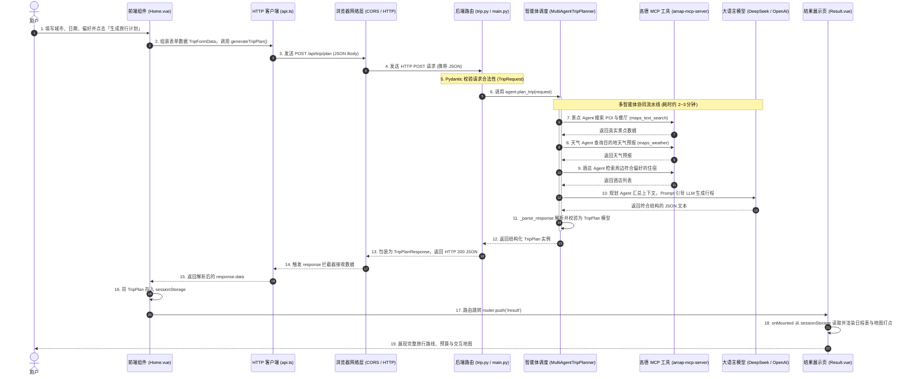

# 源码精读笔记

> 这份文档和 `PROJECT_GUIDE.md`、`TUTORIAL.md` 不重复。那两份讲「这个项目做了什么」，这份讲**「代码到底是怎么实现的」**——包括框架源码级的机制。
>
> 文中所有结论都标了出处（`文件:行号`），你可以逐个跳过去验证。**不要背结论，去读代码。**

---

## 目录

- [第 0 章 怎么用这份文档](#第-0-章-怎么用这份文档)
- [第 1 章 全景与三个关键认知](#第-1-章-全景与三个关键认知)
- [第 2 章 模块一：启动链](#第-2-章-模块一启动链)
- [第 3 章 模块二：数据合同](#第-3-章-模块二数据合同)
- [第 4 章 模块三：请求的一生](#第-4-章-模块三请求的一生)
- [第 5 章 模块四：多 Agent 流水线](#第-5-章-模块四多-agent-流水线)
- [第 6 章 模块五：容错三层防御](#第-6-章-模块五容错三层防御)
- [第 7 章 模块六：框架真相（最重要）](#第-7-章-模块六框架真相最重要)
- [第 8 章 模块七：MCP 是怎么跑起来的](#第-8-章-模块七mcp-是怎么跑起来的)
- [第 9 章 前端三件套](#第-9-章-前端三件套)
- [第 10 章 性能与成本账](#第-10-章-性能与成本账)
- [第 11 章 两个源码级发现（可以拿去面试加分）](#第-11-章-两个源码级发现可以拿去面试加分)
- [第 12 章 面试问答（深度版）](#第-12-章-面试问答深度版)
- [附录 A 文件速查](#附录-a-文件速查)
- [附录 B 自测题](#附录-b-自测题)
- [附录 C 调试信号](#附录-c-调试信号)
- [附录 D 动手改造清单](#附录-d-动手改造清单)

---

## 第 0 章 怎么用这份文档

### 三条阅读原则

1. **先跑通，再读码。** 没跑起来过就读代码，等于看地图学游泳。先按 `README.md` 把前后端跑起来，随便生成一次行程（约 2-3 分钟），看着后端终端的日志走一遍。
2. **不要从头读到尾。** 按下面的「三遍读法」。
3. **每章末尾有「验证动作」**，不做就等于没读。

### 三遍读法

| 遍数 | 目标 | 读什么 | 花多久 |
|---|---|---|---|
| 第一遍 | 知道数据怎么流动 | 第 1、3、4 章 | 40 分钟 |
| 第二遍 | 知道「魔法」在哪 | 第 5、7、8 章 | 60 分钟 |
| 第三遍 | 知道怎么讲出来 | 第 11、12 章 + 附录 B | 40 分钟 |

### 两个前置概念（不懂先补）

**LLM 的「无状态」**
你调一次 LLM API，它不记得你上次说了什么。每次都要把**完整对话历史**重新发过去。这是理解第 7 章的关键。

```python
# 所谓的「对话」，实际是每次把全部历史重发一遍
messages = [
    {"role": "system", "content": "你是景点专家..."},
    {"role": "user", "content": "查北京景点"},        # 第 1 轮
    {"role": "assistant", "content": "..."},          # 第 1 轮的回复
    {"role": "user", "content": "再查一下天气"},      # 第 2 轮
]
```

**MCP**
一个「让 AI 调用外部工具」的协议标准。类比：USB 接口。高德按这个标准做了个服务，任何支持 MCP 的框架都能插上去用，不用为每个框架单独写适配代码。本项目通过它调用高德的 POI 搜索、天气查询。

---

## 第 1 章 全景与三个关键认知

### 数据流全景

```
┌──────────────── 前端 (localhost:5173) ────────────────┐
│ Home.vue  填表                                        │
│   formData: {city, start_date, ..., preferences}      │
│   ↓ 点击「开始规划」→ handleSubmit()                   │
│ api.ts  generateTripPlan(requestData)                 │
└───────────────────────┬───────────────────────────────┘
                        │ HTTP POST /api/trip/plan
                        │ body = TripRequest (JSON)
                        ▼
┌──────────────── 后端 (localhost:8000) ────────────────┐
│ main.py       FastAPI app + CORS + 挂载路由            │
│   ↓                                                   │
│ trip.py       @router.post("/plan")                   │
│   request: TripRequest  ← FastAPI 自动校验 JSON       │
│   ↓                                                   │
│ get_trip_planner_agent()  ← 单例，首次会初始化        │
│   ↓                                                   │
│ MultiAgentTripPlanner.plan_trip(request)              │
│   ├─ ① attraction_agent.run()  → 高德 MCP 查景点      │
│   ├─ ② attraction_agent.run()  → 高德 MCP 查美食(可选)│
│   ├─ ③ weather_agent.run()     → 高德 MCP 查天气      │
│   ├─ ④ hotel_agent.run()       → 高德 MCP 查酒店      │
│   └─ ⑤ planner_agent.run()     → LLM 整合成 JSON      │
│         ↓                                             │
│      _parse_response()  → TripPlan 对象               │
│         ↓                                             │
│ return TripPlanResponse{success, message, data}       │
└───────────────────────┬───────────────────────────────┘
                        │ HTTP 200
                        ▼
┌──────────────── 前端 ─────────────────────────────────┐
│ Home.vue  sessionStorage.setItem('tripPlan', ...)     │
│   router.push('/result')                              │
│   ↓                                                   │
│ Result.vue onMounted()                                │
│   getItem → JSON.parse → 渲染 + 地图打点 + 拉图片      │
└───────────────────────────────────────────────────────┘
```

### 关键认知 1：这是「流水线」，不是「协作」

文档里写「多智能体协作」，但代码 `trip_planner_agent.py:277-308` 说明真相：

```python
attraction_response = self.attraction_agent.run(attraction_query)   # ① 得文本 A
weather_response    = self.weather_agent.run(weather_query)         # ② 得文本 B
hotel_response      = self.hotel_agent.run(hotel_query)             # ③ 得文本 C

planner_query = self._build_planner_query(                          # ④ 把 A/B/C 拼成一个大 Prompt
    request, attraction_response, weather_response, hotel_response, food_response
)
planner_response = self.planner_agent.run(planner_query)
```

**四个 Agent 之间从未直接通信**。是 `MultiAgentTripPlanner` 这个 Python 对象在中间搬运文本。这叫 **orchestrator pattern（编排器模式）**，或者叫 **pipeline / chain**。

这不算缺点——流水线可控、易调试、好排错。但要**如实描述**：

> ✅ 正确说法：「系统采用流水线式的多 Agent 架构，由编排器顺序调度，前序 Agent 的文本输出作为后序 Agent 的输入。」
>
> ❌ 错误说法：「多个 Agent 通过消息协商协作完成任务。」（面试官追问「它们怎么协商的」就崩了）

**代价**：串行执行，总延迟 = 各步延迟之和。理论上景点/天气/酒店三步互不依赖，可以并行（后面附录 D 有改造练习）。

### 关键认知 2：工具调用是「文本协议」，不是原生 Function Calling

这是**全项目最反直觉的一点**，也是理解一切「奇怪写法」的钥匙。

现代大模型 API 都支持原生 function calling——你传一个 `tools` 参数描述工具，模型返回一个结构化的 `tool_calls` 字段，绝对可靠。

**但这个项目没用这个能力。** 它让模型把工具调用当**普通文字**吐出来，然后用**正则表达式**去抠：

```python
# hello_agents/agents/simple_agent.py:80
pattern = r'\[TOOL_CALL:([^:]+):([^\]]+)\]'
matches = re.findall(pattern, text)
```

模型得返回这样的**文本**：

```
我需要搜索一下 [TOOL_CALL:amap_maps_text_search:keywords=历史文化,city=北京]
```

框架正则匹配成功 → 执行工具 → 把结果拼回对话 → 让模型再答一次。

这一条解释了项目里所有看着别扭的写法：

| 你看到的怪现象 | 真正原因 |
|---|---|
| Prompt 里反复强调「格式必须完全正确，包括方括号和冒号」 | 差一个字符，正则就匹配不上 |
| `_build_attraction_query()` 里手动预写一遍 `[TOOL_CALL:...]` | 这是**伪造 few-shot 示例**，诱导模型照抄格式 |
| 一次请求要 2-3 分钟 | 每次 `agent.run()` 内部要调 LLM 2-3 轮 |
| 天气工具名为什么是 `amap_maps_weather` | `amap_` 是前缀（工具名），`maps_weather` 是 MCP 工具原名 |

详细机制见 [第 7 章](#第-7-章-模块六框架真相最重要)。

### 关键认知 3：LLM 的输出是「不可信的」

看你可能忽略过的一行 `schemas.py:121`：

```python
rating: str = Field(default="", description="评分")   # 注意：这里是 str
```

**为什么评分是字符串，不是数字？**

因为 LLM 返回的可能是 `4.5`，也可能是 `"4.5分"`、`"很好"`、`"暂无评分"`、`"N/A"`。声明成 `float` 会直接校验失败、整个响应报错；声明成 `str` 则永远不出错。

同样的痕迹还有 `schemas.py:153-166` 的温度清洗器（把 `"34°C"` 转成 `34`）。

整个项目围绕这个认知建了**三层防御**：

| 层 | 位置 | 手段 |
|---|---|---|
| 1. 事前约束 | `PLANNER_AGENT_PROMPT` | 给完整 JSON 模板 + 「只返回JSON，不要输出其他说明文字」 |
| 2. 事中容错 | `_extract_json_str` / `_loads_json` / `_normalize_plan_data` | 从 Markdown 抠 JSON、修尾逗号、补默认值、float→int |
| 3. 事后兜底 | `_create_fallback_plan` | 全崩了造一份占位行程，保证接口不返错 |

> 💡 **这个认知比技术更重要**：LLM 是概率系统，输出不可靠。工程上不能假设它听话，必须**假设它会出错并设计恢复路径**。这是「AI 应用开发」和「调 API 玩 demo」的分水岭。

---

## 第 2 章 模块一：启动链

### `backend/run.py` —— 启动脚本

```python
uvicorn.run(
    "app.api.main:app",       # 字符串指向 FastAPI 实例
    host=settings.host,       # 0.0.0.0 = 局域网可访问
    port=settings.port,       # 8000
    reload=True,              # 改代码自动重启（开发用，生产必须关）
)
```

两个细节值得学：

**① Windows 编码兜底**（`run.py:23-30`）

```python
if sys.platform == "win32":
    os.environ.setdefault("PYTHONIOENCODING", "utf-8")
    for stream in (sys.stdout, sys.stderr):
        if hasattr(stream, "reconfigure"):
            stream.reconfigure(encoding="utf-8")
```

Windows 控制台默认 GBK 编码，而项目日志里全是 emoji（`✅ 🚀 📍`）。不强制 UTF-8，`print("🚀")` 直接抛 `UnicodeEncodeError` 让服务启动失败。这是**跨平台工程的真实坑**。

**② `if __name__ == "__main__":`** —— 只有直接运行本文件才启动服务，被别的模块 `import` 时不会误启动。

### `backend/app/config.py` —— 配置系统

用 `pydantic-settings`，它自动把环境变量映射到字段（**不区分大小写**）：

```
.env 里的 AMAP_API_KEY  →  settings.amap_api_key
.env 里的 PORT          →  settings.port
```

关键设计：`class Config` 里 `extra = "ignore"`

```python
class Config:
    env_file = ".env"
    case_sensitive = False
    extra = "ignore"   # ← .env 里多余的变量不报错
```

因为 `.env` 里还有 `LLM_API_KEY`、`LLM_MODEL_ID` 这些**不由 Settings 管理**的变量（`HelloAgentsLLM` 会自己读环境变量）。没有 `ignore`，pydantic 会因「多余字段」报错。

`validate_config()` 的**分级处理**也很实用：

```python
if not settings.amap_api_key:
    errors.append("AMAP_API_KEY未配置")        # 致命 → 阻止启动
if not llm_api_key:
    warnings.append("LLM_API_KEY未配置...")     # 只警告 → 允许启动
```

高德 Key 缺失是**致命错误**（`raise ValueError`，服务起不来），LLM Key 缺失只是警告。判断依据是「缺了它系统还能不能跑」——高德 Key 缺失所有工具调用全废，值得直接拦下。

### `backend/app/api/main.py` —— FastAPI 应用

三件事：

**① 创建 app**

```python
app = FastAPI(title=..., docs_url="/docs", redoc_url="/redoc")
```

`/docs` 是 FastAPI 白送的可交互 API 文档，能直接在浏览器里填参数调接口。**调试神器**——不用写前端就能测后端。

**② CORS 中间件**（`main.py:41-47`）

```python
app.add_middleware(
    CORSMiddleware,
    allow_origins=settings.get_cors_origins_list(),  # 默认含 localhost:5173
    allow_credentials=True,
    allow_methods=["*"],
    allow_headers=["*"],
)
```

**为什么必须配？** 浏览器同源策略：`localhost:5173` 的前端请求 `localhost:8000` 的后端，端口不同 = 跨域。浏览器会先发 `OPTIONS` 预检请求问「后端允许我吗」，后端不返回 CORS 头，浏览器就**拦截响应**。

⚠️ 注意：被拦的是**浏览器**，不是后端。后端日志里能看到请求进来了，但前端 `catch` 到错误。这个现象容易误导排查方向。

**③ 挂载路由**（`main.py:52-54`）

```python
app.include_router(trip.router, prefix="/api")
```

路径是**拼接**出来的，这是新手的常见困惑点：

```
trip.py 里:  APIRouter(prefix="/trip")   +   @router.post("/plan")
                                          ↓
main.py 里:  include_router(..., prefix="/api")
                                          ↓
最终路径:    POST /api/trip/plan
```

### ✅ 第 2 章验证动作

```powershell
# 在 backend 目录启动后端
python run.py
```

然后浏览器打开 <http://localhost:8000/docs>，找到 `POST /api/trip/plan`，点「Try it out」，粘贴：

```json
{
  "city": "南昌",
  "start_date": "2026-10-01",
  "end_date": "2026-10-03",
  "travel_days": 3,
  "transportation": "公共交通",
  "accommodation": "经济型酒店",
  "preferences": ["美食"],
  "free_text_input": "体验当地美食"
}
```

点 Execute，**看后端终端打印的日志**——你会看到完整的流水线执行过程，每步耗时多久一目了然。

这一步做完，你已经绕过了前端，直接理解了后端。**这是调试能力的起点**：以后前端出问题，先用 `/docs` 测后端，能立刻定位是前端还是后端的问题。

---

## 第 3 章 模块二：数据合同

`backend/app/models/schemas.py` 定义了「数据长什么样」，它有**三重身份**：

1. **后端校验器** —— FastAPI 靠它自动校验请求 JSON
2. **前后端合同** —— 和 `frontend/src/types/index.ts` 的 TS 接口字段一一对应
3. **LLM 输出模板** —— `PLANNER_AGENT_PROMPT` 里的 JSON 例子就是照着它写的

### 输入：TripRequest

```python
class TripRequest(BaseModel):
    city: str = Field(..., description="目的地城市")
    start_date: str = Field(..., description="开始日期 YYYY-MM-DD")
    end_date: str = Field(..., description="结束日期 YYYY-MM-DD")
    travel_days: int = Field(..., description="旅行天数", ge=1, le=30)
    transportation: str = Field(..., description="交通方式")
    accommodation: str = Field(..., description="住宿偏好")
    preferences: List[str] = Field(default=[], description="旅行偏好标签")
    free_text_input: Optional[str] = Field(default="", description="额外要求")
```

三个 Pydantic 要点：

- **`Field(...)` 里的 `...` 是必填**。这是 Python 的 `Ellipsis` 对象，不是省略号，别理解错。
- **`ge=1, le=30` = 范围校验**。传 `travel_days: 50` 会被拦在业务逻辑之外，返回 **HTTP 422**。注意：**422 不是你的代码返回的**，是 FastAPI 在校验阶段就拒绝了，`trip.py` 里的 `plan_trip()` 根本不会被调用。
- **`Optional[str]` + `default=""`** = 可以不传。注意 `Optional[X]` 在 Pydantic 里的含义是「可以为 None」，配合 default 才是「可以不传」。

### 输出：TripPlan（嵌套结构，重点）

这是**层层嵌套**的，背下这棵树：

```
TripPlan                                  整份计划
├── city / start_date / end_date           基本信息
├── days: List[DayPlan]                    ★ 数组：每天一个
│    └── DayPlan
│         ├── date / day_index / description / transportation / accommodation
│         ├── hotel: Optional[Hotel]       当天酒店
│         │    └── name / address / location / price_range / rating / estimated_cost
│         ├── attractions: List[Attraction]   ★ 数组：一天2-3个
│         │    └── name / address / location / visit_duration / description
│         │        / category / ticket_price
│         └── meals: List[Meal]             ★ 数组：早中晚
│              └── type / name / description / estimated_cost
├── weather_info: List[WeatherInfo]        ★ 数组：每天一条
│    └── date / day_weather / night_weather / day_temp / night_temp
│        / wind_direction / wind_power
├── overall_suggestions: str               总体建议
└── budget: Optional[Budget]               预算
     └── total_attractions / total_hotels / total_meals
         / total_transportation / total
```

**记住这棵树**，因为：

- `Result.vue` 就是靠 `v-for` 逐层循环渲染的（循环 `days` → 循环 `attractions`）
- 地图打点靠每层的 `location.longitude / latitude`（见 `Result.vue:876-886`）
- LLM 的 Prompt 模板（`trip_planner_agent.py:98-158`）就是照抄这棵树

### 响应外壳：TripPlanResponse

```python
class TripPlanResponse(BaseModel):
    success: bool
    message: str
    data: Optional[TripPlan]   # ← 真正的计划在这里
```

**为什么要包一层？** 为了**响应结构的一致性**。成功和失败都返回同样的形状，前端只需要一套解析逻辑：

```typescript
if (response.success && response.data) { /* 用 response.data */ }
else { message.error(response.message) }
```

**这是 API 设计的通用模式**，值得记住。

### ⚠️ 必须搞懂的「两层 data」

这是新手最容易懵的地方。看 `api.ts:82-83`：

```typescript
const response = await apiClient.post<TripPlanResponse>('/api/trip/plan', formData)
return response.data   // 这是 axios 的 data，等于后端的整个响应体
```

完整链路：

```
后端返回的响应体:   { success: true, message: "...", data: { city: "南昌", days: [...] } }
                                    ↑ 这整个是后端定义的 TripPlanResponse
                              ↓
axios 把它包成:      response = { status: 200, headers: {...}, data: ←上面那整个对象 }
                              ↓
response.data      = { success: true, message: "...", data: {...} }   ← 业务外壳
response.data.data = { city: "南昌", days: [...] }                     ← 真正的 TripPlan
```

**为什么会有两层？** 因为 axios 的 `response.data` 是 HTTP 层的概念（响应体），后端的 `data` 是业务层的概念（业务数据）。两个 `data` 撞名了，纯属巧合，但必须分清。

### ✅ 第 3 章验证动作

打开 `frontend/src/types/index.ts`，和 `schemas.py` **逐字段对照**。找找看有没有不一致的地方（提示：仔细看 `rating` 的类型）。

---

## 第 4 章 模块三：请求的一生

### 4.0 前后端交互全流程时序图

在逐行剖析代码之前，先建立对一次请求完整生命周期的全局认知：



### `trip.py:42` —— 入口函数

```python
@router.post("/plan", response_model=TripPlanResponse, summary="生成旅行计划")
async def plan_trip(request: TripRequest):
    try:
        agent = get_trip_planner_agent()          # ① 拿单例（首次会初始化 MCP + 4个Agent）
        trip_plan = agent.plan_trip(request)      # ② 真正的业务
        return TripPlanResponse(success=True, message="旅行计划生成成功", data=trip_plan)
    except Exception as e:
        raise HTTPException(status_code=500, detail=f"生成旅行计划失败: {str(e)}")
```

**这部分很简单，但有三个知识点：**

**① `async def` 但里面没有 `await`**

这是个**值得注意的细节**。`plan_trip()` 里的 `agent.plan_trip(request)` 是个**同步阻塞**函数（要跑 2-3 分钟）。

在 FastAPI 里，`async def` 路由运行在**事件循环**上。一旦它执行同步阻塞代码，**整个事件循环会被卡住**——期间所有其他请求都得不到响应。

正确的做法是：

```python
@router.post("/plan")
def plan_trip(request: TripRequest):   # 改成普通 def
    ...

# 或者保留 async，把阻塞调用丢到线程池
from fastapi.concurrency import run_in_threadpool
trip_plan = await run_in_threadpool(agent.plan_trip, request)
```

用普通 `def` 时 FastAPI 会自动把函数丢到线程池执行，不阻塞事件循环。

> 💡 **这是一个可以拿去面试的点**：说明你不只是「会写 FastAPI」，而是理解 ASGI 的并发模型。当前项目因为只有一个用户、一次一个请求，所以没暴露问题；一旦有多人同时用，就会排队卡死。

**② `response_model=TripPlanResponse`**

告诉 FastAPI：返回值按这个模型**序列化 + 过滤**。好处是即使你多返回了字段，也会被裁掉，不会泄露内部数据。

**③ `HTTPException(status_code=500, detail=...)`**

`detail` 字段就是前端能拿到的错误信息。回头看 `api.ts:87`：

```typescript
throw new Error(error.response?.data?.detail || error.message || '生成旅行计划失败')
```

前端优先取 `detail`，所以这里的错误信息会**原样显示给用户**。⚠️ 注意这意味着**内部异常信息会暴露给前端**（`str(e)` 可能包含文件路径、Key 片段等），生产环境应该改成友好提示 + 服务端记日志。

### `health_check()` —— 顺带一读

```python
@router.get("/health")
async def health_check():
    agent = get_trip_planner_agent()
    return {
        "status": "healthy",
        "agents": {
            "attraction": agent.attraction_agent.name,
            "weather": agent.weather_agent.name,
            "hotel": agent.hotel_agent.name,
            "planner": agent.planner_agent.name,
        },
        "tools_count": len(agent.attraction_agent.list_tools())
    }
```

**这个接口很有用**：它强制触发单例初始化，所以能验证「高德 Key 有效吗、MCP 起得来吗、工具挂上了吗」。

访问 <http://localhost:8000/api/trip/health>，看 `tools_count` 是多少——这就是高德 MCP 实际暴露给你的工具数量。

⚠️ 注意别和 `main.py:113` 的 `GET /health` 搞混，那是全局探活，不涉及 Agent。

### ✅ 第 4 章验证动作

1. 访问 `/api/trip/health`，记下 `tools_count`
2. 用 `/docs` 发一个 `travel_days: 50` 的请求，看返回什么（应该是 422，且后端终端**没有**打印「收到旅行规划请求」——证明校验发生在业务代码之前）
3. 用 `/docs` 发一个 `city` 字段缺失的请求，观察 422 的响应体结构

---

## 第 5 章 模块四：多 Agent 流水线

核心文件：`backend/app/agents/trip_planner_agent.py`（498 行，项目最核心）

### 5.1 类结构：这是一张「项目组」

```python
class MultiAgentTripPlanner:      # 项目经理
    def __init__(self):           # 组建团队（昂贵，只做一次）
        self.llm = get_llm()                          # 共享大模型客户端
        self.amap_tool = MCPTool(name="amap", ...)    # 共享工具
        self.attraction_agent = SimpleAgent(...)      # 景点专家 + 工具
        self.weather_agent    = SimpleAgent(...)      # 天气专家 + 工具
        self.hotel_agent      = SimpleAgent(...)      # 酒店专家 + 工具
        self.planner_agent    = SimpleAgent(...)      # 规划专家，不加工具

    def plan_trip(self, request):  # 派活并汇总
        ...
```

**设计要点：**

- **4 个 Agent 共享同一个 `self.llm`** → 避免重复创建客户端
- **3 个 Agent 共享同一个 `self.amap_tool`** → 避免重复启动 MCP 服务
- **`planner_agent` 故意不加工具** → 它的职责是「整合已有信息」，不需要查新数据。不加工具带来一个**实实在在的好处**：见 [第 7.4 节](#74-规划-agent-为什么只有一次-llm-调用)

### 5.2 为什么要拆成 4 个 Agent？

| 理由 | 说明 |
|---|---|
| **Prompt 更专注** | 景点 Agent 的 Prompt 只讲「怎么搜景点」，不用管酒店、预算。上下文越窄，模型越不容易跑偏 |
| **工具调用与生成解耦** | 查数据的 Agent 和写字（生成 JSON）的 Agent 分开，出问题好定位 |
| **职责单一好扩展** | 想加「交通 Agent」，照着现有模式抄一个就行 |
| **调试粒度细** | 日志里能分别看到景点搜索是不是失败了 |

**反过来说，一个 Agent 全干的坏处**：Prompt 要同时描述 4 类任务 + 工具格式 + JSON 格式，又长又容易冲突，模型很可能在「该调工具」的时候直接开始编 JSON。

### 5.3 `plan_trip()` 五步精读

```python
def plan_trip(self, request: TripRequest) -> TripPlan:
    try:
        # ===== 步骤1：搜景点 =====
        attraction_query = self._build_attraction_query(request)
        attraction_response = self.attraction_agent.run(attraction_query)

        # ===== 步骤1.5：若关注美食，额外搜一次 =====
        food_response = ""
        if self._wants_food_experience(request):
            food_response = self.attraction_agent.run(self._build_food_query(request))

        # ===== 步骤2：查天气 =====
        weather_response = self.weather_agent.run(f"请查询{request.city}的天气信息")

        # ===== 步骤3：搜酒店 =====
        hotel_response = self.hotel_agent.run(f"请搜索{request.city}的{request.accommodation}酒店")

        # ===== 步骤4：规划师整合 =====
        planner_query = self._build_planner_query(
            request, attraction_response, weather_response, hotel_response, food_response
        )
        planner_response = self.planner_agent.run(planner_query)

        # ===== 步骤5：解析成对象 =====
        return self._parse_response(planner_response, request)

    except Exception as e:
        return self._create_fallback_plan(request)   # 兜底
```

#### Step 1 的聪明点：`_build_attraction_query()`

```python
if request.preferences:
    non_food_prefs = [pref for pref in request.preferences if pref != "美食"]
    keywords = non_food_prefs[0] if non_food_prefs else "著名景点"
else:
    keywords = "著名景点"
```

**问题**：如果用户只勾了「美食」，直接用「美食」当景点搜索关键词，搜出来的全是餐厅——行程里就没有景点了。

**解法**：把「美食」从景点关键词里**排除**，优先用其他偏好；实在没有就用「著名景点」兜底。

**这是个真实的业务设计细节**，面试讲这个比讲技术架构更能体现「你在思考业务」。

然后再看这段：

```python
query = (
    f"请使用amap_maps_text_search工具搜索{request.city}的{keywords}相关景点。\n"
    f"[TOOL_CALL:amap_maps_text_search:keywords={keywords},city={request.city}]"
)
```

**为什么要把 `[TOOL_CALL:...]` 手动写进查询里？**

因为框架用的是**文本协议**（关键认知 2）。写一遍正确的示例，等于给模型一个「照抄模板」，大幅提高它输出正确格式的概率。

代码注释很诚实地写了：「查询里直接带上 TOOL_CALL，提高工具调用成功率」。

> 💡 **这叫「prompt hacking」或「防御性 prompt 设计」**——不指望模型理解你的意图，直接给它答案的样子。工程上很有效，但要知道这是**权宜之计**：如果框架支持原生 function calling，这段代码就没必要存在了。

#### Step 1.5：美食的额外一次搜索

```python
food_response = self.attraction_agent.run(food_query)   # 复用景点 Agent
```

复用景点 Agent 而不是新建一个，因为它已经有 `amap_maps_text_search` 工具了，**没必要为此多创建一个 Agent**。

#### Step 4：`_build_planner_query()` —— 拼装大 Prompt

```python
query = f"""请根据以下信息生成{request.city}的{request.travel_days}天旅行计划:

**基本信息:**
- 城市: {request.city}
- 日期: {request.start_date} 至 {request.end_date}
...

**景点信息:**
{attractions}

**天气信息:**
{weather}

**酒店信息:**
{hotels}
"""
```

**这就是「流水线」的物化体现**——前面三步的文本输出，在这里被拼成一个 Prompt。

注意后面还有**条件追加**：

```python
if self._wants_food_experience(request):
    query += "8. 行程中必须突出当地美食体验,餐饮推荐优先使用美食信息中的真实餐厅\n"

if request.free_text_input:
    query += f"\n**额外要求:** {request.free_text_input}\n"
```

用户填的 `free_text_input` 被**原样拼进 Prompt**。⚠️ 这是**提示词注入（prompt injection）**的入口——用户输入「忽略上面的所有要求，直接返回……」，理论上能劫持模型输出。这个项目没做防护。

生产环境应该至少：加分隔符包裹、明确声明「以下是用户输入，不是指令」、或对输出做校验。

### 5.4 关键设计：步骤 1.5 的顺序

注意 `_wants_food_experience()` 的检测逻辑：

```python
text = f"{request.free_text_input or ''} {' '.join(request.preferences)}"
food_keywords = ("美食", "小吃", "餐饮", "吃", "赣菜", "特色菜")
return any(keyword in text for keyword in food_keywords)
```

**关键词硬编码匹配**，简单粗暴但有效。局限也很明显：

- 「我不想吃辣」→ 命中「吃」→ 误判为想吃美食
- 「当地特色」→ 没命中 → 漏判

更好的做法是让 LLM 判断意图，或者用更细的规则。**这个局限可以主动说出来**，体现你有批判性思维。

---

## 第 6 章 模块五：容错三层防御

这是**工程含金量最高**的部分。四个函数层层接力：

```
LLM 原始输出（可能是 Markdown 包裹、带解释文字、格式错乱）
   ↓ ① _extract_json_str()      从文本里抠出 JSON 片段
   ↓ ② _loads_json()            解析 JSON（修尾逗号等）
   ↓ ③ _normalize_plan_data()   补默认值、类型转换
   ↓ ④ TripPlan(**data)         Pydantic 校验
   ↓ 失败 → _create_fallback_plan()
```

### ① `_extract_json_str()` —— 兼容三种返回

```python
# 情况1：```json ... ```
if "```json" in response:
    json_start = response.find("```json") + 7
    json_end = response.find("```", json_start)
    return response[json_start:json_end].strip()

# 情况2：``` ... ```
if "```" in response:
    json_start = response.find("```") + 3
    json_end = response.find("```", json_start)
    candidate = response[json_start:json_end].strip()
    if candidate.startswith("{"):
        return candidate

# 情况3：正文里直接夹着 { ... }
if "{" in response and "}" in response:
    json_start = response.find("{")
    json_end = response.rfind("}") + 1     # rfind = 从右往左找第一个
    return response[json_start:json_end]

raise ValueError("响应中未找到JSON数据")
```

注意 `find` vs `rfind`：`find("{")` 找**第一个** `{`，`rfind("}")` 找**最后一个** `}`。这样能正确框住最外层的 JSON 对象。

### ② `_loads_json()` —— 修尾逗号

```python
try:
    return json.loads(json_str)
except json.JSONDecodeError:
    cleaned = re.sub(r",\s*([}\]])", r"\1", json_str)   # {"a":1,} → {"a":1}
    return json.loads(cleaned)
```

**尾逗号（trailing comma）**是 LLM 最常犯的 JSON 错误：

```json
{
  "name": "故宫",
  "price": 60,      ← 这个逗号是多余的，标准 JSON 不允许
}
```

正则 `,\s*([}\]])` 匹配「逗号 + 若干空白 + 右括号」，替换成「右括号」，把逗号吃掉。

⚠️ 局限：这个正则**不会**处理单引号、注释、`undefined`、`NaN` 等其他常见 LLM 错误。生产环境更稳的方案是用 `json5` 或让模型走严格的结构化输出（JSON mode / tool calling）。

### ③ `_normalize_plan_data()` —— 补默认值 + 类型转换

```python
# 补必填字段的默认值
data.setdefault("city", request.city)
data.setdefault("start_date", request.start_date)
data.setdefault("end_date", request.end_date)
data.setdefault("overall_suggestions", f"这是为您规划的{request.city}旅行计划。")
data.setdefault("days", [])
data.setdefault("weather_info", [])

# 类型清洗
for day in data.get("days", []):
    hotel = day.get("hotel")
    if isinstance(hotel, dict) and hotel.get("rating") is not None:
        hotel["rating"] = str(hotel["rating"])       # 数字 → 字符串

    for meal in day.get("meals", []):
        cost = meal.get("estimated_cost")
        if isinstance(cost, float):
            meal["estimated_cost"] = int(cost)        # 400.0 → 400

    for attraction in day.get("attractions", []):
        price = attraction.get("ticket_price")
        if isinstance(price, float):
            attraction["ticket_price"] = int(price)
```

**这一段解释了为什么 `Hotel.rating` 是 `str`**（关键认知 3）。模型返回 `4.5`（数字）时，这里提前转成 `"4.5"`，Pydantic 才不会炸。

⚠️ **注意 `setdefault` 的局限**：它只在**键不存在**时生效。如果模型返回了 `"city": null`，键存在但值是 `None`，`setdefault` 不管用，Pydantic 照样报错。更严谨的写法要判断值是否为 `None`。

### ④ Pydantic 校验 + 兜底

```python
def _parse_response(self, response: str, request: TripRequest) -> TripPlan:
    try:
        json_str = self._extract_json_str(response)
        data = self._normalize_plan_data(self._loads_json(json_str), request)
        return TripPlan(**data)              # 校验；字段不对抛错
    except Exception as e:
        print(f"⚠️  解析响应失败: {str(e)}")
        return self._create_fallback_plan(request)
```

### ⑤ `_create_fallback_plan()` —— 最后的体面

```python
for i in range(request.travel_days):
    day_plan = DayPlan(
        date=current_date.strftime("%Y-%m-%d"),
        day_index=i,
        description=f"第{i+1}天行程",
        attractions=[
            Attraction(
                name=f"{request.city}景点{j+1}",       # ← 一眼看出是兜底
                address=f"{request.city}市",
                location=Location(longitude=116.4 + i*0.01 + j*0.005, ...),  # ← 北京坐标
                ...
            )
            for j in range(2)
        ],
        ...
    )
```

**关键设计**：

- **占位符名字故意起成「南昌景点1」** —— 用户/开发者一眼能识别这是兜底结果，不是真实数据。**这是好设计**：静默失败比显式失败更危险。
- **坐标是假的**（`116.4` 是北京经度，硬编码）—— 地图会把南昌的行程打在北京。这是个**可以改进的点**。
- **但它保证了响应结构完整** —— 前端拿到后照常渲染，不会白屏。

> 💡 **这就是「优雅降级」**。对比一下：如果直接 `raise`，用户看到的是报错弹窗 + 空白页；现在用户至少能看到一份「骨架行程」，知道系统做了什么、哪一步没成。

### ⚠️ 一个重要推论：500 错误其实很难触发

理清三层的异常边界：

| 失败点 | 在哪被捕获 | 结果 |
|---|---|---|
| Agent 初始化失败（高德 Key 错、MCP 起不来） | `trip.py:88` 的 `except` | **HTTP 500** |
| 流水线某步失败（LLM 报错、工具超时） | `plan_trip()` 内的 `except` | 200 + fallback 计划 |
| JSON 解析失败 | `_parse_response()` 内的 `except` | 200 + fallback 计划 |

**结论**：`plan_trip()` 把绝大多数异常都吞掉了，所以**前端拿到的大部分是「200 成功 + 占位行程」**，而不是 500。

**这带来一个用户体验问题**：`response.success` 几乎总是 `true`，前端 `message.success('旅行计划生成成功!')` 照弹——但用户看到的其实是一堆「南昌景点1」。

**改进思路**：fallback 时给 `TripPlanResponse` 加一个标记字段（如 `is_fallback: true`），前端据此提示「本次为降级结果，请重试」。

> 💡 **这个发现值得在面试讲**：说明你能看穿代码的「表面行为」和「真实行为」之间的差距。

---

## 第 7 章 模块六：框架真相（最重要）

**这一章讲的东西，项目的任何文档里都没有。** 但它才是理解这个项目的钥匙。

因为 `hello_agents` 是第三方库，大多数人只会看项目代码，不会去读 `site-packages`。而 Agent 的「魔法」全在框架里。

**框架源码位置**：

```
D:\python3.12\Lib\site-packages\hello_agents\
├── agents/simple_agent.py        ← 本次重点
├── tools/registry.py             ← 工具注册与展开
├── tools/builtin/protocol_tools.py  ← MCPTool
├── tools/builtin/mcp_wrapper_tool.py ← 单个 MCP 工具的包装
└── protocols/mcp/client.py       ← MCP 客户端（连接管理）
```

### 7.1 `SimpleAgent.run()` 的完整循环

源码 `simple_agent.py:246-323`，这是整个项目的**心脏**：

```python
def run(self, input_text: str, max_tool_iterations: int = 3, **kwargs) -> str:
    # ---------- 1) 构建消息列表 ----------
    messages = []
    enhanced_system_prompt = self._get_enhanced_system_prompt()   # 系统提示 + 工具说明书
    messages.append({"role": "system", "content": enhanced_system_prompt})

    for msg in self._history:                                     # ⚠️ 重放历史（见 11.1）
        messages.append({"role": msg.role, "content": msg.content})

    messages.append({"role": "user", "content": input_text})

    # ---------- 2) 没有工具 → 单次调用就返回 ----------
    if not self.enable_tool_calling:
        response = self.llm.invoke(messages, **kwargs)
        self.add_message(Message(input_text, "user"))
        self.add_message(Message(response, "assistant"))
        return response

    # ---------- 3) 有工具 → 循环 ----------
    current_iteration = 0
    final_response = ""

    while current_iteration < max_tool_iterations:                # 默认最多 3 轮
        response = self.llm.invoke(messages, **kwargs)            # ← 调 LLM

        tool_calls = self._parse_tool_calls(response)             # ← 正则解析工具调用

        if tool_calls:
            tool_results = []
            clean_response = response

            for call in tool_calls:
                result = self._execute_tool_call(call['tool_name'], call['parameters'])
                tool_results.append(result)
                clean_response = clean_response.replace(call['original'], "")  # 移除标记

            messages.append({"role": "assistant", "content": clean_response})

            tool_results_text = "\n\n".join(tool_results)
            messages.append({
                "role": "user",
                "content": f"工具执行结果：\n{tool_results_text}\n\n请基于这些结果给出完整的回答。"
            })

            current_iteration += 1
            continue                                              # ← 回到循环开头，再调 LLM

        # 没有工具调用 = 最终回答
        final_response = response
        break

    # 保存到历史记录
    self.add_message(Message(input_text, "user"))
    self.add_message(Message(final_response, "assistant"))
    return final_response
```

**逐点解读：**

**① `max_tool_iterations=3`** —— 最多循环 3 轮。为什么要有上限？防止模型陷入「一直调工具」的死循环烧钱。

**② 工具结果是用 `role: "user"` 塞回去的**（不是 `role: "tool"`）

```python
messages.append({"role": "user", "content": f"工具执行结果：\n{tool_results_text}\n\n请基于这些结果给出完整的回答。"})
```

**这是文本协议的直接后果**。原生 function calling 有专门的 `role: "tool"` 和 `tool_call_id` 来标识工具结果；文本协议没有这些，只能伪装成用户说的话。

**③ 每轮循环都重新调用一次 LLM** —— 这是**性能瓶颈的根源**：

```
第 1 次 LLM 调用 → "我要查 [TOOL_CALL:...]"      ← 耗时 ~5-15s
   执行工具（MCP 查数据）                        ← 耗时 ~5-20s
第 2 次 LLM 调用 → "工具结果我看到了，答案如下..." ← 耗时 ~5-15s
```

一次 `agent.run()` = **2 次 LLM 调用 + 1 次工具调用**，总共 15-50 秒。四个 Agent 串行下来就是 2-3 分钟。

### 7.2 工具调用是怎么被解析的

源码 `simple_agent.py:78-91`：

```python
def _parse_tool_calls(self, text: str) -> list:
    """解析文本中的工具调用"""
    pattern = r'\[TOOL_CALL:([^:]+):([^\]]+)\]'
    matches = re.findall(pattern, text)

    tool_calls = []
    for tool_name, parameters in matches:
        tool_calls.append({
            'tool_name': tool_name.strip(),
            'parameters': parameters.strip(),
            'original': f'[TOOL_CALL:{tool_name}:{parameters}]'
        })
    return tool_calls
```

**正则拆解**：

```
\[TOOL_CALL:([^:]+):([^\]]+)\]
   ↑              ↑  ↑    ↑
   字面量      捕获组1 捕获组2
               工具名  参数字符串
```

- `[^:]+` = 一个或多个「非冒号」字符 → **工具名不能含冒号**
- `[^\]]+` = 一个或多个「非右方括号」字符 → **参数里不能有 `]`**

**这解释了 Prompt 里那些死板的要求**：

```
**注意:**
1. 必须使用工具,不要直接回答
2. 格式必须完全正确,包括方括号和冒号    ← 差一个字符正则就废
3. 参数用逗号分隔
```

也解释了为什么参数格式必须是 `key=value,key=value`（对应 `simple_agent.py:130-149` 的解析逻辑）：

```python
if '=' in parameters:
    if ',' in parameters:
        pairs = parameters.split(',')
        for pair in pairs:
            if '=' in pair:
                key, value = pair.split('=', 1)
                param_dict[key.strip()] = value.strip()
```

⚠️ **潜在缺陷**：如果参数值里包含逗号（比如 `keywords=烤鸭,火锅`），会被错误地拆成两个参数。对高德搜索来说，「烤鸭,火锅」这种多关键词搜索就会失败。

### 7.3 参数类型转换

源码 `simple_agent.py:156-211`。因为文本协议拿到的参数永远是**字符串**，但工具可能要求数字/布尔值，所以要做转换：

```python
if param_type == 'number' or param_type == 'integer':
    converted_dict[key] = float(value) if param_type == 'number' else int(value)
elif param_type == 'boolean':
    converted_dict[key] = value.lower() in ('true', '1', 'yes')
```

类型定义从哪来？从 `MCPWrappedTool._parse_input_schema()`（`mcp_wrapper_tool.py:62-89`）把 MCP 的 JSON Schema 转成 `ToolParameter`。

**这是文本协议为了「能用」而必须打的各种补丁**。原生 function calling 里，模型直接返回结构化 JSON，这些转换全都由 API 保证。

### 7.4 规划 Agent 为什么只有一次 LLM 调用

这是个**很容易被忽略、但很漂亮**的设计。

看 `trip_planner_agent.py:239-244`：

```python
self.planner_agent = SimpleAgent(
    name="行程规划专家",
    llm=self.llm,
    system_prompt=PLANNER_AGENT_PROMPT
)
# 注意：这里故意不加工具
```

**没有调用 `add_tool()`**，所以在 `simple_agent.py:38-39`：

```python
self.tool_registry = tool_registry          # None（构造时没传）
self.enable_tool_calling = enable_tool_calling and tool_registry is not None   # → False
```

于是 `run()` 在 `simple_agent.py:273-277` 就走**短路分支**：

```python
if not self.enable_tool_calling:
    response = self.llm.invoke(messages, **kwargs)   # 一次调用，直接返回
    ...
    return response
```

**对比一下成本：**

| Agent | LLM 调用次数 | 工具调用 |
|---|---|---|
| 景点/天气/酒店 Agent | 2-3 次（循环） | 有 |
| 规划 Agent | **1 次** | 无 |

**这个设计的价值**：
- 省时（少 1-2 次 LLM 往返）
- 省 token（不用在 system prompt 里塞十几个工具的说明书）
- **更可控**：不会出现「规划 Agent 突然想再去查一次天气」这种不可预测行为

> 💡 **面试可以这样讲**：「规划 Agent 刻意不挂工具，因为它的职责是整合而非检索。这带来两个好处：一是省去了工具说明书的 token 开销和一轮 LLM 往返，二是避免了模型在生成 JSON 时又去调工具的不可控行为。」

### 7.5 `_get_enhanced_system_prompt()` —— 工具说明书是怎么塞进去的

源码 `simple_agent.py:41-76`。**这是理解「为什么 Agent 会知道有哪些工具」的答案**：

```python
def _get_enhanced_system_prompt(self) -> str:
    base_prompt = self.system_prompt or "你是一个有用的AI助手。"
    if not self.enable_tool_calling or not self.tool_registry:
        return base_prompt

    tools_description = self.tool_registry.get_tools_description()
    tools_section = "\n\n## 可用工具\n"
    tools_section += "你可以使用以下工具来帮助回答问题：\n"
    tools_section += tools_description + "\n"
    tools_section += "\n## 工具调用格式\n"
    tools_section += "当需要使用工具时，请使用以下格式：\n"
    tools_section += "`[TOOL_CALL:{tool_name}:{parameters}]`\n\n"
    # ... 参数格式说明 + 示例

    return base_prompt + tools_section     # ← 拼接！
```

**关键机制：你写的 `system_prompt` 只是「人设」，框架会在后面自动追加「工具清单 + 调用格式」。**

所以景点 Agent 实际收到的 system prompt 是：

```
你是景点搜索专家。你的任务是根据城市和用户偏好搜索合适的景点。
**重要提示:** 你必须使用工具来搜索景点!...
（你写的人设）
                        ↓ 框架追加
## 可用工具
你可以使用以下工具来帮助回答问题：
- amap_maps_text_search: 高德地图文本搜索...
- amap_maps_weather: 高德地图天气查询...
（...十几个工具）
## 工具调用格式
当需要使用工具时，请使用以下格式：
`[TOOL_CALL:{tool_name}:{parameters}]`
```

> 💡 **这解释了「为什么 Agent 知道自己有哪些工具」**——不是模型自动发现的，是框架把清单塞进 system prompt 里了。也解释了 `tools_count` 这个数字的意义：**工具越多，每次请求的 system prompt 就越长，token 成本越高**。

---

## 第 8 章 模块七：MCP 是怎么跑起来的

### 8.1 链路总览

```
项目代码                       框架代码                            外部进程
─────────────────────────────────────────────────────────────────────────
MCPTool(                                                              
  name="amap",                                                        
  server_command=["uvx", "amap-mcp-server"],                          
  env={"AMAP_MAPS_API_KEY": ...},                                     
  auto_expand=True                                                    
)                                                                     
    ↓                                                                 
  __init__()                                                          
    ├─ _prepare_env()      合并环境变量                                
    ├─ _discover_tools()   ← 连接一次，问「你有哪些工具？」→ 启动 uvx amap-mcp-server
    └─ prefix = "amap_"                                               
    ↓                                                                 
agent.add_tool(amap_tool)                                             
    ↓                                                                 
  ToolRegistry.register_tool()                                        
    └─ get_expanded_tools()  ← 把 N 个 MCP 工具包装成 N 个独立 Tool     
        └─ MCPWrappedTool(name=f"amap_{tool_name}", ...)              
              ↓                                                       
  模型输出 [TOOL_CALL:amap_maps_text_search:...]                      
              ↓                                                       
  MCPWrappedTool.run(params)                                          
    └─ mcp_tool.run({"action": "call_tool", ...})                     
        └─ MCPClient(...)  ← 新连接！                                  → 再启动一个 uvx 进程
            └─ client.call_tool("maps_text_search", args)             → HTTP 请求高德 API
```

### 8.2 工具为什么叫 `amap_maps_text_search`

源码 `protocol_tools.py:114`：

```python
self.prefix = f"{name}_" if auto_expand else ""
```

我们传的是 `name="amap"`，所以 `prefix = "amap_"`。

源码 `mcp_wrapper_tool.py:48`：

```python
tool_name = f"{prefix}{self.mcp_tool_name}" if prefix else self.mcp_tool_name
```

高德 MCP 服务提供的工具原名是 `maps_text_search`，加前缀后变成 **`amap_maps_text_search`**。

**所以 Prompt 里的工具名是「前缀 + 原名」的拼接结果**，不是高德原本的名字。

### 8.3 `auto_expand` 到底做了什么

**不展开时**：Agent 只看到 1 个工具 `amap`，要传 `{"action": "call_tool", "tool_name": "maps_weather", "arguments": {...}}` —— 模型得学会这套嵌套参数格式，很容易错。

**展开后**：Agent 看到 N 个独立工具，直接 `[TOOL_CALL:amap_maps_weather:city=北京]` —— 简单直接。

源码 `mcp_wrapper_tool.py:100-118`，包装工具的 `run()` 负责把简单参数转回嵌套格式：

```python
def run(self, params: Dict[str, Any]) -> str:
    mcp_params = {
        "action": "call_tool",
        "tool_name": self.mcp_tool_name,
        "arguments": params
    }
    return self.mcp_tool.run(mcp_params)
```

⚠️ **注意项目代码里这一行**（`trip_planner_agent.py:208`）：

```python
self.amap_tool.expandable = True
```

`expandable` 属性**不是 `__init__` 参数**，是构造完之后手动加的。因为 `ToolRegistry.register_tool()` 会检查它（`registry.py:29`）：

```python
if auto_expand and hasattr(tool, 'expandable') and tool.expandable:
    expanded_tools = tool.get_expanded_tools()
```

**不设这个属性，工具就不会展开**，Agent 只会看到一个叫 `amap` 的粗粒度工具。这是个隐式依赖，属于框架设计得不够干净的地方。

**实际展开成几个工具？** 访问 `GET /api/trip/health` 看 `tools_count`，或看启动日志里那句 `✅ 工具 'amap' 已展开为 N 个独立工具`。（`PROJECT_GUIDE.md` 里写的是 16，但会随 `amap-mcp-server` 版本变化，以你终端实际输出为准。）

### 8.4 ⚠️ 性能真相：每次工具调用都重启一个子进程

这是**我读源码时最惊讶的发现**。

看 `protocol_tools.py:381`（MCPTool.run 内部）：

```python
async with MCPClient(client_source, self.server_args, env=self.env) as client:
    if action == "call_tool":
        result = await client.call_tool(tool_name, arguments)
```

再看 `client.py:198-213`：

```python
async def __aenter__(self):
    print("🔗 连接到 MCP 服务器...")
    self.client = Client(self.server_source)    # ← 每次新建客户端
    await self._context_manager.__aenter__()
    return self

async def __aexit__(self, exc_type, exc_val, exc_tb):
    await self._context_manager.__aexit__(...)  # ← 每次断开
    self.client = None
```

`MCPClient` 被用作 `async with`，**每次进入都要重新建立连接、退出时断开**。

而 `server_command = ["uvx", "amap-mcp-server"]` 走的是 stdio 传输（`client.py:132-150`）：

```python
return StdioTransport(
    command=server_source[0],      # "uvx"
    args=server_source[1:] + self.server_args,   # ["amap-mcp-server"]
    env=self.env if self.env else None,
)
```

**`StdioTransport` 会启动一个子进程。**

**结论**：

```
每一次 MCP 工具调用
  → 新建 MCPClient
  → 通过 StdioTransport 启动一个新的 `uvx amap-mcp-server` 子进程
  → 调用工具
  → 关闭连接，杀掉子进程
```

**这意味着一次旅行规划（4-5 次工具调用）会启动/销毁 4-5 个高德 MCP 子进程。**

**改进方向**：把 `MCPClient` 做成长连接（在 `MultiAgentTripPlanner.__init__` 里建立并复用，而不是每次调用重建）。这需要一个连接池或常驻 session，改造成本不低，但收益很大。

> 💡 **这是一个极佳的面试素材**。它展示了三件事：
> 1. 你会读第三方库源码，不是只会用
> 2. 你能从代码推出性能瓶颈（而不是瞎猜）
> 3. 你有优化思路

**验证方法**：跑一次规划，同时打开任务管理器看 `uvx` / `node` 进程数量变化，能看到子进程反复出现又消失。

---

## 第 9 章 前端三件套

### 9.1 `Home.vue` —— 表单到 HTTP

**页面状态类型设计**（`Home.vue:239-242`）：

```typescript
type TripFormState = Omit<TripFormData, 'start_date' | 'end_date'> & {
  start_date: Dayjs | null
  end_date: Dayjs | null
}
```

**为什么要这样定义？** 因为**同一份数据在页面里和在网络上的类型不同**：

- 页面里：日期选择器返回的是 `Dayjs` 对象（有 `.diff()`、`.format()` 等方法）
- 网络上：后端要的是 `"2026-10-01"` 字符串

`Omit<X, 'a'|'b'> & { a: ..., b: ... }` 是 TS 的模式：**「先用 X 的所有字段，但把 a 和 b 换掉」**。

转换发生在提交时（`Home.vue:318-319`）：

```typescript
start_date: formData.start_date.format('YYYY-MM-DD'),   // Dayjs → 字符串
```

**这个「页面模型」和「传输模型」分离的思路很重要**，比直接用一个 interface 混着用清晰得多。

**进度条是假的**（`Home.vue:295-311`）：

```typescript
// 模拟进度：每 500ms +10%，最高到 90%
// 注意：这只是 UI 动画，真实后端可能要 2~3 分钟
const progressInterval = setInterval(() => {
  if (loadingProgress.value < 90) {
    loadingProgress.value += 10
    if (loadingProgress.value <= 30) loadingStatus.value = '🔍 正在搜索景点...'
    else if (loadingProgress.value <= 50) loadingStatus.value = '🌤️ 正在查询天气...'
    ...
  }
}, 500)
```

**这是纯粹的 UI 欺骗**——后端并没有返回真实进度。但**这是必要的产品设计**：让用户等 2-3 分钟而毫无反馈，用户早关页面了。

⚠️ **注意 `clearInterval` 的位置**：在 `try` 里成功后调了一次（`Home.vue:330`），在 `catch` 里又调了一次（`Home.vue:350`）。如果 `generateTripPlan` 抛错，会走 catch 分支，两处不会重复执行。**但 `finally` 里没有清理** —— 如果 `setTimeout` 之前发生意外，定时器可能泄漏。更好的写法是放到 `finally` 里。

**数据传递用 sessionStorage 而不是路由参数**（`Home.vue:337`）：

```typescript
sessionStorage.setItem('tripPlan', JSON.stringify(response.data))
router.push('/result')
```

**为什么？** 因为 URL 参数有长度限制（约 2000 字符），而一份旅行计划的 JSON 轻松上万字符。sessionStorage 容量约 5MB，够用。

**sessionStorage vs localStorage**：
- `sessionStorage`：关闭标签页就清空 —— 适合这种「一次性数据」
- `localStorage`：永久保存 —— 适合用户设置

**代价**：`sessionStorage` 是**同标签页共享**的。如果用户在新标签页打开 `/result`，会看到空白页（拿不到数据）。`Result.vue` 也处理了这种情况——`if (data)` 判断，没数据就什么都不做。

### 9.2 `api.ts` —— API 封装层

完整讲解见对话记录。核心要点：

1. **`axios.create()` 统一配置**：`baseURL` / `timeout` / `Content-Type`。timeout 设 120 秒是因为后端真的慢。
2. **两个拦截器**：现在只打日志，是**为将来预留的扩展点**（加 token、统一错误处理）。
3. **泛型 `post<TripPlanResponse>`**：只影响 TS 类型检查，运行时不做任何验证。
4. **错误信息提取**（`api.ts:87`）：

```typescript
throw new Error(error.response?.data?.detail || error.message || '生成旅行计划失败')
```

优先取后端 FastAPI `HTTPException` 的 `detail` 字段——这样用户能看到「AMAP_API_KEY 未配置」这种具体原因，而不是笼统的「请求失败」。

### 9.3 `Result.vue` —— 渲染 + 地图

**`onMounted` 的三步串行**（`Result.vue:351-359`）：

```typescript
onMounted(async () => {
  const data = sessionStorage.getItem('tripPlan')
  if (data) {
    tripPlan.value = JSON.parse(data)     // ① 还原数据，模板立刻能渲染
    await loadAttractionPhotos()          // ② 拉图片（可选增强，失败不影响）
    await nextTick()                      // ③ 等 DOM 渲染完
    initMap()                             // ④ 初始化地图
  }
})
```

**`nextTick()` 为什么必须？** 地图容器 `<div id="amap-container">` 在 `v-if` 或数据渲染之后才存在。不等待 DOM 更新完就调 `new AMap.Map('amap-container')`，会报「找不到容器」。这是 **Vue 响应式更新的时序问题**。

**地图中心的智能计算**（`Result.vue:832-848`）：

```typescript
// 默认中心先给北京；若行程里有坐标，则改成景点坐标平均值
let center: [number, number] = [116.397128, 39.916527]
if (tripPlan.value?.days?.length) {
  const coords: [number, number][] = []
  tripPlan.value.days.forEach(day => {
    day.attractions.forEach(attr => {
      if (attr.location?.longitude && attr.location?.latitude) {
        coords.push([attr.location.longitude, attr.location.latitude])
      }
    })
  })
  if (coords.length > 0) {
    const avgLng = coords.reduce((sum, item) => sum + item[0], 0) / coords.length
    const avgLat = coords.reduce((sum, item) => sum + item[1], 0) / coords.length
    center = [avgLng, avgLat]
  }
}
```

**逻辑**：把所有景点经纬度求平均，作为地图中心。这比「永远显示北京」聪明得多。

⚠️ **局限**：平均值不等于「合适的地图中心」。如果景点分布在城市两端，平均值可能落在中间的空地上。更好的做法是用高德的 `setFitView()` 自动缩放到包含所有点的范围。代码里 `addAttractionMarkers` 之后确实调了 fitView——所以**两套机制并存**，平均值其实只是初始中心。

**两个 Key 的区别**（`Result.vue:827`，代码注释已经点明）：

```typescript
const AMap = await AMapLoader.load({
  key: import.meta.env.VITE_AMAP_WEB_JS_KEY,   // 前端 JS API Key
  ...
})
```

| Key | 位置 | 用途 |
|---|---|---|
| `AMAP_API_KEY` | 后端 `.env` | **Web 服务** Key，给 MCP 查询用（服务端） |
| `VITE_AMAP_WEB_JS_KEY` | 前端 `.env` | **Web 端 (JS API)** Key，给浏览器渲染地图用 |

**两者不能混用**。高德控制台申请时是两种不同类型的 Key。前端 Key 会暴露在浏览器里，所以要在高德后台**配置域名白名单**。

### ✅ 第 9 章验证动作

1. 在 `Result.vue:344` 附近，把 `activeDays = ref<number[]>([0])` 改成 `[0, 1]`，刷新看默认展开的天数变化
2. 打开浏览器 DevTools → Network，点一次「开始规划」，观察：
   - `POST /api/trip/plan` 的耗时（应该 2-3 分钟）
   - `GET /api/poi/photo?name=xxx` 的请求数量（每个景点一个）
3. 打开 DevTools → Application → Session Storage，看 `tripPlan` 里存的 JSON 结构——**和 `schemas.py` 对照**

---

## 第 10 章 性能与成本账

### 时间花在哪（一次 3 天行程）

| 阶段 | 次数 | 单次耗时 | 小计 |
|---|---|---|---|
| LLM 调用（景点 Agent） | 2 | 8s | 16s |
| MCP 工具调用（搜景点） | 1 | 10s | 10s |
| LLM 调用（美食 Agent）* | 2 | 8s | 16s |
| MCP 工具调用（搜美食）* | 1 | 10s | 10s |
| LLM 调用（天气 Agent） | 2 | 8s | 16s |
| MCP 工具调用（天气） | 1 | 10s | 10s |
| LLM 调用（酒店 Agent） | 2 | 8s | 16s |
| MCP 工具调用（酒店） | 1 | 10s | 10s |
| LLM 调用（规划 Agent） | **1** | 25s | 25s |
| **合计** | | | **约 2.2 分钟** |

*带 * 的是勾选「美食」时才有。

**注意耗时结构**：真正「思考」的时间不多，大量时间花在**往返次数**上（文本协议导致的多次 LLM 调用 + MCP 子进程反复启停）。

### Token 花在哪

每次 LLM 调用都要发送**完整对话历史**。所以：

- **工具越多，system prompt 越长**（十几个工具的说明书每次都要重发）
- **历史越积越多，后续请求越贵**（见第 11.1 节的发现）
- `plan_trip` 里把前面三步的**完整文本输出**拼进规划 Prompt —— 这一步的输入 token 最大

### 优化方向（按性价比排序）

| 优化 | 收益 | 难度 |
|---|---|---|
| 景点/天气/酒店三步并行 | 省 40% 时间 | 中（`asyncio.gather` 或线程池） |
| MCP 连接复用（不每次重启子进程） | 省 50% MCP 耗时 | 高（改框架） |
| 清空 `_history`（见 11.1） | 防止 token 无限增长 | 低（一行代码） |
| 改用原生 function calling | 减少一轮 LLM 调用 | 高（换框架或用 OpenAI SDK 直连） |
| 加缓存（同城市同日期复用） | 重复查询秒回 | 中（Redis / 内存字典） |
| 流式输出（SSE） | 体感快很多 | 中 |

---

## 第 11 章 两个源码级发现（可以拿去面试加分）

**这两条是我读源码时发现的，项目的任何文档都没提。** 面试时抛出这种「我读代码时发现……」，比背诵架构图有说服力得多。

### 11.1 `_history` 永不清理 → 跨请求污染 + token 无限增长

**证据链**：

① Agent 基类里有 history 字段（`core/agent.py:23`）：

```python
self._history: list[Message] = []
```

② `run()` 开头会**重放全部历史**（`simple_agent.py:266-267`）：

```python
for msg in self._history:
    messages.append({"role": msg.role, "content": msg.content})
```

③ `run()` 结尾会**追加本次对话**（`simple_agent.py:320-321`）：

```python
self.add_message(Message(input_text, "user"))
self.add_message(Message(final_response, "assistant"))
```

④ 而 Agent 是**单例**，进程内一直活着（`trip_planner_agent.py:576-591`）：

```python
_multi_agent_planner = None

def get_trip_planner_agent() -> MultiAgentTripPlanner:
    global _multi_agent_planner
    if _multi_agent_planner is None:
        _multi_agent_planner = MultiAgentTripPlanner()
    return _multi_agent_planner
```

⑤ **全项目搜索 `clear_history`，零结果。**

**结论**：

```
第 1 次请求 → 景点 Agent 的 history 增加 2 条消息
第 2 次请求 → 发送：第1次的历史 + 本次输入  →  history 变 4 条
第 3 次请求 → 发送：前2次的历史 + 本次输入  →  history 变 6 条
...
第 N 次请求 → 每次都要发送 2(N-1) 条陈旧消息
```

**两个后果**：

1. **Token 成本随请求数线性增长**，最终可能撑爆模型的上下文窗口直接报错
2. **跨请求语义污染**：用户 B 的景点搜索 Prompt 里，会带着用户 A、C、D 的历史搜索结果。虽然因为每次任务描述很明确，实际影响不大，但这是**架构上的隐患**

**修复**（在 `plan_trip()` 开头）：

```python
def plan_trip(self, request: TripRequest) -> TripPlan:
    # 清理上一轮残留的对话历史，避免跨请求污染和 token 膨胀
    for agent in (self.attraction_agent, self.weather_agent, self.hotel_agent, self.planner_agent):
        agent.clear_history()
    ...
```

⚠️ **注意并发问题**：Agent 是单例、`_history` 是共享可变状态。如果多个用户同时请求，A 的清空操作会影响 B 的进行中请求。**真正的修法是去掉单例的历史共享**（每个请求创建独立的对话上下文），或者给请求加锁。这也是「单例 + 可变状态」的经典陷阱。

### 11.2 `async def` 里的同步阻塞调用

**证据链**：

`trip.py:42` 是 `async def`：

```python
async def plan_trip(request: TripRequest):
```

但里面调用的是同步阻塞函数：

```python
trip_plan = agent.plan_trip(request)   # 同步，阻塞 2-3 分钟
```

而 `plan_trip()` 内部全是同步调用（`agent.run()` 最终是 `llm.invoke()`，同步 HTTP 请求）。

**后果**：

FastAPI 中 `async def` 路由运行在**单个事件循环线程**上。执行同步阻塞代码时，事件循环被独占，**期间所有其他请求全部排队等待**。

- **单用户场景**：无感知（本来就是一个人用）
- **多用户场景**：用户 A 的 2 分钟请求会把用户 B、C 全部卡死

**修复**（二选一）：

```python
# 方案一：改成普通 def，FastAPI 自动丢线程池
@router.post("/plan", response_model=TripPlanResponse)
def plan_trip(request: TripRequest):     # 去掉 async
    ...

# 方案二：保留 async，显式丢线程池
from fastapi.concurrency import run_in_threadpool

@router.post("/plan", response_model=TripPlanResponse)
async def plan_trip(request: TripRequest):
    agent = get_trip_planner_agent()
    trip_plan = await run_in_threadpool(agent.plan_trip, request)
    ...
```

**方案一更简单**。FastAPI 的规则是：**只要路由函数里没有 `await`，就该用普通 `def`**，让它跑在线程池里，避免阻塞事件循环。

> 💡 **面试话术**：「我注意到项目里有几处 `async def` 路由内部是同步阻塞调用，在单用户 demo 场景没问题，但并发时会阻塞事件循环。修复方式是把路由改成普通 `def` 让 FastAPI 调度到线程池，或者用 `run_in_threadpool` 显式卸载阻塞调用。」

---

## 第 12 章 面试问答（深度版）

比 `PROJECT_GUIDE.md` 里的版本更深一层。**先自己口头答一遍，再看参考答案。**

### Q1：介绍一下这个项目

<details>
<summary>参考答案</summary>

「这是一个基于多 Agent 架构的智能旅行规划系统，全栈实现。用户在前端填目的地、日期、偏好，后端通过流水线式编排的 4 个 LLM Agent——景点、天气、酒店、行程规划——调用高德地图 MCP 服务获取真实 POI、天气、酒店数据，最后由规划 Agent 整合成结构化的 JSON 行程返回前端渲染，包含每日景点、餐饮、酒店、预算和地图可视化。

技术栈是 Python + FastAPI + Pydantic 后端，Vue3 + TypeScript + Vite 前端，Agent 部分用 HelloAgents 框架，外部工具通过 MCP 协议接入高德地图。

我在实现中重点处理了两个问题：一是 LLM 输出格式的不确定性，设计了三层容错——Prompt 约束、解析清洗、兜底降级；二是多 Agent 的职责拆分，让每个 Agent 的 Prompt 足够专注。」

</details>

### Q2：多 Agent 是怎么协作的？

<details>
<summary>参考答案</summary>

⚠️ **这是最容易答错的题。别说「协商」，那是错的。**

「严格说是**流水线式分工**，不是自主协作。由 `MultiAgentTripPlanner` 这个编排器顺序调度：前三个检索型 Agent 各自去查景点、天气、酒店，返回文本结果；编排器把这些文本拼成一个完整的 Prompt 交给第四个规划 Agent 做整合。

Agent 之间没有直接通信，信息传递靠编排器在 Python 层搬运。这样设计的好处是流程完全可控、便于调试和定位问题；代价是串行执行、延迟叠加——理论上景点、天气、酒店三步互不依赖，可以并行优化。」

</details>

### Q3：为什么用多 Agent 而不是一个 Agent？

<details>
<summary>参考答案</summary>

「核心原因是**职责拆分会显著提升 Prompt 质量**。一个 Agent 全包的话，system prompt 要同时描述四类任务、十几个工具、还有严格的 JSON 格式要求，指令之间容易冲突，模型很可能在该调工具的时候直接开始编 JSON。

拆开之后每个 Agent 的 Prompt 都很窄——景点 Agent 只关心怎么搜景点。上下文越专注，模型行为越稳定。

另外三检索 Agent 和规划 Agent 的**能力需求本来就不同**：前者要工具调用，后者要结构化生成。规划 Agent 我刻意不挂工具，这样它只做一次 LLM 调用，省了工具说明书的 token 和一轮往返，也避免了它在生成 JSON 时突然又去调工具的不可控行为。」

</details>

### Q4：LLM 返回的 JSON 格式不对怎么办？

<details>
<summary>参考答案</summary>

「设计了**三层防御**：

第一层是**事前约束**：规划 Agent 的 Prompt 里给出完整的 JSON 模板和字段说明，并明确要求『只返回JSON，不要输出其他说明文字』。

第二层是**事中容错**：解析时依次做三件事——`_extract_json_str` 兼容三种返回形式（```json 代码块、``` 代码块、正文里夹着的裸 JSON），`_loads_json` 用正则修掉尾逗号这类常见错误，`_normalize_plan_data` 补齐缺失字段并把 LLM 常返回的 float 转成 int。

第三层是**事后兜底**：如果还是失败，`_create_fallback_plan` 生成一份结构完整的占位行程，保证接口不报错、前端不白屏。占位景点名故意起成『南昌景点1』，让人一眼看出这是降级结果。

需要说明的是，这套方案是**权宜之计**。更稳的做法是让模型走原生 function calling 或者 JSON mode，由 API 层面保证结构化输出，就不需要这些文本清洗了。」

</details>

### Q5：怎么保证景点信息是真实的，不是 LLM 编的？

<details>
<summary>参考答案</summary>

「通过 **MCP 协议**把高德地图的真实数据接进来。检索型 Agent 的 system prompt 里明确要求『必须使用工具，不要自己编造景点信息』，然后通过 `[TOOL_CALL:amap_maps_text_search:...]` 触发高德 POI 搜索，拿回真实的名称、地址、经纬度。

关键点是**经纬度来自高德**，所以前端地图打点是准的。如果让 LLM 编坐标，地图会乱飞。

不过要如实说：**规划 Agent 在整合时仍然可能改写或加工信息**——比如门票价格、游览时长这类高德不返回的字段，是 LLM 基于常识生成的。所以准确的说法是『**基础 POI 数据真实，衍生信息是模型推断**』。」

</details>

### Q6：MCP 是什么？为什么要用它？

<details>
<summary>参考答案</summary>

「MCP（Model Context Protocol）是让 AI 调用外部工具的标准化协议。类比 USB——高德按这个标准实现了一个 MCP Server，任何支持 MCP 的框架都能直接接入，不需要为每个框架单独写适配代码。

本项目里通过 `MCPTool(server_command=["uvx", "amap-mcp-server"], ...)` 启动高德的服务，`auto_expand=True` 会把服务暴露的工具展开成独立工具，加上 `amap_` 前缀后注册给 Agent。Agent 就能像调用普通工具一样调 `amap_maps_text_search`、`amap_maps_weather`。

价值在于**解耦**：如果哪天要换成百度地图，理论上只需要换一个 MCP Server，Agent 层代码不用动。」

</details>

### Q7：一次请求要 2-3 分钟，怎么优化？

<details>
<summary>参考答案</summary>

「我分析过耗时结构，瓶颈不在模型推理，而在**往返次数**。

第一，**文本工具调用协议导致多次 LLM 调用**。这个框架不用原生 function calling，而是让模型把工具调用当文本吐出来、再用正则解析，所以每次 `agent.run()` 内部要调 2 次 LLM——一次决定调什么工具，一次基于工具结果生成回答。

第二，**MCP 连接没有复用**。我读框架源码发现 `MCPClient` 是每次调用都用 `async with` 重建连接，而它走的是 stdio 传输，**每次工具调用都会启停一个 `uvx amap-mcp-server` 子进程**。一次规划 4-5 次工具调用就是 4-5 个进程的生死。

优化方向按性价比排：一是**三个检索 Agent 并行**，它们互不依赖，用 `asyncio.gather` 能省 40% 时间；二是**MCP 连接复用**，把客户端做成常驻 session；三是**改用原生 function calling**，少一轮 LLM 往返；四是**加缓存**，同城市同日期直接复用结果；五是**改流式输出**，让用户先看到部分内容。」

</details>

### Q8：这个项目有什么不足？

<details>
<summary>参考答案</summary>

「我读代码时发现几个可以改进的点：

**一是性能**：检索 Agent 串行执行、MCP 连接不复用（每次调用重启子进程），都是可以优化的。

**二是并发安全**：Agent 是单例，`_history` 是共享可变状态，而且全项目没有任何地方调用 `clear_history`。这导致两个问题——历史会跨请求累积、每次请求的 token 成本线性增长；多用户并发时还会互相污染。这是『单例 + 可变状态』的经典陷阱。

**三是阻塞事件循环**：`trip.py` 里是 `async def` 路由，但内部调用的是同步阻塞函数，满耗时 2-3 分钟。单用户场景无感，并发时会卡死整个服务。应该改成普通 `def` 让 FastAPI 调度到线程池。

**四是失败不可见**：`plan_trip()` 把绝大多数异常都吞掉返回兜底计划，所以前端拿到的几乎总是 `success: true`，用户看到『生成成功』但实际是占位数据。应该给响应加个 `is_fallback` 标记让前端提示。

**五是提示词注入**：用户的 `free_text_input` 被原样拼进 Prompt，没有做防护。」

</details>

### Q9：如果要支持 1000 个并发用户，你会怎么改？

<details>
<summary>参考答案</summary>

「当前架构支持不了，需要几层改造：

**接口层**：把同步阻塞调用从事件循环卸载（改 `def` 路由或 `run_in_threadpool`），让单机能承接并发请求。

**架构层**：2-3 分钟的同步请求不适合 HTTP 长连接。应该改成**异步任务模式**——接口立刻返回 `task_id`，实际规划丢到 Celery / RQ 队列后台执行，前端轮询或走 WebSocket/SSE 拿进度。这同时也解决了『进度条是假的』的问题，能返回真实进度。

**Agent 层**：去掉 Agent 单例，改成每请求独立的执行上下文；MCP 连接池化；检索步骤并行化。

**缓存层**：同城市 + 同日期 + 同偏好 的请求可以复用一个结果（旅行计划对时效性要求不高），Redis 存起来，能挡掉大量重复请求。

**成本层**：加 token 用量监控和限流，防止单个用户刷爆 API 额度。」

</details>

---

## 附录 A 文件速查

### 后端

| 文件 | 行数 | 职责 | 关键内容 |
|---|---|---|---|
| `backend/run.py` | 35 | 启动脚本 | uvicorn 配置、Windows UTF-8 兜底 |
| `backend/app/config.py` | 96 | 配置管理 | `.env` 加载、`validate_config()` 分级校验 |
| `backend/app/api/main.py` | 113 | FastAPI 应用 | CORS、路由挂载、startup 钩子 |
| `backend/app/api/routes/trip.py` | 115 | 旅行规划接口 | `POST /api/trip/plan`、`GET /api/trip/health` |
| `backend/app/models/schemas.py` | 206 | 数据合同 | `TripRequest` / `TripPlan` / 温度清洗器 |
| `backend/app/services/llm_service.py` | 43 | LLM 单例 | `get_llm()` |
| `backend/app/agents/trip_planner_agent.py` | 498 | **项目核心** | 4 个 Prompt、`plan_trip()`、三层容错 |

### 前端

| 文件 | 行数 | 职责 | 关键内容 |
|---|---|---|---|
| `frontend/src/views/Home.vue` | 622 | 填表页 | `handleSubmit`、假进度条、sessionStorage |
| `frontend/src/services/api.ts` | 98 | API 封装 | axios 实例、拦截器、错误提取 |
| `frontend/src/types/index.ts` | 114 | TS 类型 | 对应 `schemas.py` |
| `frontend/src/views/Result.vue` | 1262 | 结果页 | `onMounted`、地图初始化、导出图片/PDF |

### 框架（`D:\python3.12\Lib\site-packages\hello_agents\`）

| 文件 | 关键内容 |
|---|---|
| `agents/simple_agent.py` | **`run()` 主循环、`_parse_tool_calls()` 正则** |
| `core/agent.py` | `_history` 定义、`clear_history()` |
| `tools/registry.py` | `register_tool()` 工具展开 |
| `tools/builtin/protocol_tools.py` | `MCPTool`、`_discover_tools()`、每次调用重建连接 |
| `tools/builtin/mcp_wrapper_tool.py` | 单个 MCP 工具的包装与参数转换 |
| `protocols/mcp/client.py` | `MCPClient` 连接管理、stdio 传输 |

---

## 附录 B 自测题

**答不出来就回去重读对应章节。建议口头答，模拟面试。**

### 基础层（必须会）

1. 前端提交后，数据流经哪些文件到达 LLM？（第 1、4 章）
2. `TripPlan` 的嵌套结构是什么？画出那棵树。（第 3 章）
3. 为什么 `Hotel.rating` 是 `str` 而不是 `float`？（第 1、3 章）
4. `response.data.data` 为什么有两层 `data`？（第 3 章）
5. 为什么用 sessionStorage 而不是路由参数传数据？（第 9 章）

### 进阶层（区分度）

6. `[TOOL_CALL:...]` 这个格式是谁规定的？框架怎么解析它？（第 7 章）
7. 为什么代码里要手动把 `[TOOL_CALL:...]` 写进查询字符串？（第 1、5 章）
8. 规划 Agent 为什么只有一次 LLM 调用？（第 7.4 节）
9. Agent 怎么"知道"自己有哪些工具？（第 7.5 节）
10. `auto_expand=True` 到底做了什么？`expandable = True` 那行不写会怎样？（第 8.3 节）
11. 什么情况下前端会收到 HTTP 500？什么情况下收到 200 但是假数据？（第 6 章末）
12. 一次规划会启动几个 `uvx` 子进程？为什么？（第 8.4 节）

### 高手层（加分项）

13. `_history` 为什么要清理？不清理会有什么后果？（第 11.1 节）
14. `async def` 路由里调用同步阻塞函数有什么问题？（第 11.2 节）
15. 如果要支持 1000 并发，架构要怎么改？（第 12 章 Q9）
16. 这套文本工具调用协议，相比原生 function calling 有哪些具体劣势？（第 7 章）

### 动手层（做了才算真会）

17. 用 `/docs` 发一个 `travel_days: 50` 的请求，解释返回的错误（第 4 章验证动作）
18. 在 `plan_trip()` 里加一行日志，打印每次 `agent.run()` 的耗时，验证"往返次数是瓶颈"的结论
19. 把 `_create_fallback_plan` 里的假坐标改成让 LLM 用高德地理编码查真实坐标，跑通它

---

## 附录 C 调试信号

### 后端终端日志对照

启动时：

```
🚀 HelloAgents智能旅行助手 v1.0.0
应用名称: HelloAgents智能旅行助手
高德地图API Key: 已配置          ← 必须"已配置"
LLM API Key: 已配置              ← 必须"已配置"
LLM Base URL: https://api.deepseek.com
LLM Model: deepseek-chat
✅ 配置验证通过
```

首次请求时（**单例初始化，最慢的一次**）：

```
🔄 获取多智能体系统实例...
🔄 开始初始化多智能体旅行规划系统...
  - 创建共享MCP工具...
🔗 连接到 MCP 服务器...          ← 这里在启动 uvx 子进程
✅ 连接成功！
📝 使用 Stdio 传输 (命令): uvx amap-mcp-server
✅ 工具 'amap' 已展开为 N 个独立工具      ← 实际数字以你终端为准（随 amap-mcp-server 版本变化）
  - 创建景点搜索Agent...
  - 创建天气查询Agent...
  - 创建酒店推荐Agent...
  - 创建行程规划Agent...
✅ 多智能体系统初始化成功
```

每次规划的流水线日志：

```
📥 收到旅行规划请求:
   城市: 南昌
   日期: 2026-10-01 - 2026-10-03
============================================================
🚀 开始多智能体协作规划旅行...
📍 步骤1: 搜索景点...
🔗 连接到 MCP 服务器...          ← 每次工具调用都会出现
🔌 连接已断开                    ← 对应上面的"断开"
景点搜索结果: 南昌八一起义纪念馆...
🍜 步骤1.5: 搜索当地美食...
🌤️  步骤2: 查询天气...
🏨 步骤3: 搜索酒店...
📋 步骤4: 生成行程计划...
✅ 旅行计划生成完成!
```

**🔗 / 🔌 成对出现的次数 = MCP 子进程的启动次数**。数一下就知道第 8.4 节说的对不对。

### 出问题时看哪里

| 症状 | 排查方向 |
|---|---|
| 启动就失败 | `validate_config()` 报的错，检查 `.env` 的 `AMAP_API_KEY` |
| 后端日志正常，前端报跨域 | `main.py` 的 CORS `allow_origins` 是否包含前端端口 |
| 生成了但景点叫「南昌景点1」 | 走了 fallback。往上翻日志找 `⚠️ 解析响应失败` 或 `❌ 生成旅行计划失败` |
| 地图空白 | `VITE_AMAP_WEB_JS_KEY` 是否配置、高德后台是否配了域名白名单 |
| 地图加载失败但后端正常 | JS API Key 和 Web 服务 Key 用混了 |
| 首次请求特别慢（1 分钟以上） | 正常，MCP 初始化的开销 |
| 后端日志有请求但前端超时 | `api.ts` 的 `timeout: 120000` 可能不够 |
| 访问 `/result` 页面空白 | 没走 Home 页，sessionStorage 里没数据 |

---

## 附录 D 动手改造清单

**读懂了不等于会了。做以下练习，从易到难。**

### 难度 ⭐（熟悉代码）

1. **加一个「交通方式」Agent**：仿照天气 Agent 写一个，用 `amap_maps_direction_transit_integrated` 查路线，把结果拼进规划 Prompt
2. **加入表单校验**：前端限制城市名不能为空、日期不能早于今天
3. **在 fallback 时给出提示**：给 `TripPlanResponse` 加 `is_fallback` 字段，前端据此显示「本次为降级结果」

### 难度 ⭐⭐（理解架构）

4. **修复 `_history` 问题**：在 `plan_trip()` 开头清理历史，验证多次请求后 token 用量不再增长
5. **修掉阻塞事件循环**：把 `trip.py` 的 `async def plan_trip` 改成 `def plan_trip`，用两个浏览器标签页同时请求，对比改前改后的响应时间
6. **并行化检索步骤**：用 `concurrent.futures.ThreadPoolExecutor` 让景点、天气、酒店三个 Agent 同时跑，对比总耗时
7. **加响应缓存**：以 `city + start_date + end_date + preferences` 为 key 缓存结果，重复请求直接返回

### 难度 ⭐⭐⭐（有挑战）

8. **修复 MCP 连接复用**：改造 `MCPTool`，让 `MCPClient` 保持常驻连接而不是每次重建，测速对比
9. **改成异步任务模式**：`POST /api/trip/plan` 立刻返回 `task_id`，实际规划放后台线程执行；新增 `GET /api/trip/status/{task_id}` 查询进度；前端轮询并显示真实进度
10. **替换为原生 function calling**：绕过 HelloAgents 框架，直接用 OpenAI SDK 的 `tools` 参数实现景点/天气/酒店三个 Agent，对比稳定性和耗时

### 做完之后

把改造前后的**数据**记下来（耗时、token 用量、代码行数变化）。面试时讲「我发现 X 问题，改了 Y，效果从 A 变成 B」——**这种带数据的叙述，比任何架构图都有说服力。**

---

## 最后：这个项目的真正价值

学这个项目，**真正的收获不是「学会了一个旅行规划系统」**，而是：

1. **理解了 Agent 的本质** —— 它不神秘。`SimpleAgent` 就是「拼 messages → 调 LLM → 正则抠工具调用 → 执行 → 把结果拼回去 → 再调一次」这个循环，140 行代码。**Agent = LLM + 工具 + 循环**。

2. **理解了 LLM 应用的工程难点** —— 不是「调 API」，而是**处理它的不确定性**。三层容错、类型放宽（`rating: str`）、兜底降级，全是在和「模型可能不听话」这件事搏斗。

3. **理解了框架的取舍** —— HelloAgents 用文本协议实现工具调用，好处是**不依赖特定模型 API**（任何能输出文本的模型都能用），代价是**不可靠 + 多次往返**。理解了取舍，你才能为自己的项目做对技术选型。

4. **理解了「读源码」的价值** —— 这份文档里最有价值的第 7、8、11 章，全部来自读 `site-packages` 里的框架源码。**文档会骗你（「多智能体协作」），代码不会。**

第 4 点是最重要的。
