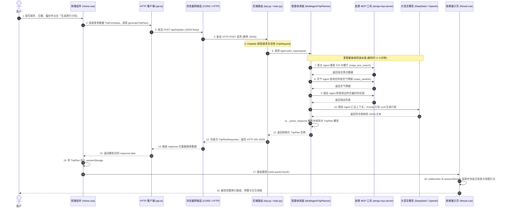

# HelloAgents 智能旅行助手 — 项目理解指南

> 本文档帮助你快速理解 `helloagents-trip-planner` 项目，便于写简历、面试讲解和二次开发。  
> 对应教程：[Hello-Agents 第十三章 智能旅行助手](https://hello-agents.datawhale.cc/#/./chapter13/%E7%AC%AC%E5%8D%81%E4%B8%89%E7%AB%A0%20%E6%99%BA%E8%83%BD%E6%97%85%E8%A1%8C%E5%8A%A9%E6%89%8B)

---

## 一、30 秒认识这个项目

**一句话**：用户在前端填写旅行需求，后端通过 **多个 AI Agent 协作**，调用 **高德地图 MCP 工具** 获取真实 POI/天气/酒店信息，再由 LLM 整合生成 **结构化多日旅行计划**，前端展示行程、预算和地图。

**项目定位**：

- 不是简单的 ChatGPT 对话页
- 是一个 **Agent + Tool Calling + 全栈工程** 的落地项目
- 核心亮点：**多智能体分工**、**MCP 外部工具接入**、**结构化 JSON 输出**

---

## 二、技术栈一览

| 层级 | 技术 | 作用 |
|------|------|------|
| AI 框架 | HelloAgents (`SimpleAgent`, `HelloAgentsLLM`) | Agent 编排与 LLM 调用 |
| 工具协议 | MCP (`MCPTool` + `amap-mcp-server`) | 接入高德地图能力 |
| 后端 | Python、FastAPI、Pydantic | REST API、数据校验 |
| 前端 | Vue 3、TypeScript、Vite、Ant Design Vue | 表单、结果展示 |
| 地图 | 高德 Web JS API | 景点标注与路线 |
| 图片 | Unsplash API | 景点配图（可选） |
| LLM | DeepSeek 等 OpenAI 兼容 API | 行程规划与文本生成 |

---

## 三、系统架构

```
┌─────────────────────────────────────────────────────────────┐
│                        前端 (Vue3)                           │
│  Home.vue 填表  ──POST──▶  api.ts  ──▶  Result.vue 展示结果   │
└───────────────────────────────┬─────────────────────────────┘
                                │ HTTP
                                ▼
┌─────────────────────────────────────────────────────────────┐
│                     后端 (FastAPI)                           │
│  trip.py  ──▶  MultiAgentTripPlanner.plan_trip()            │
│                     │                                        │
│     ┌───────────────┼───────────────┐                       │
│     ▼               ▼               ▼                       │
│  景点 Agent    天气 Agent     酒店 Agent                     │
│     │               │               │                       │
│     └───────────────┴───────────────┘                       │
│                     │ MCP 工具调用                           │
│                     ▼                                       │
│              amap-mcp-server (高德)                          │
│                     │                                       │
│                     ▼                                       │
│              规划 Agent + LLM ──▶ TripPlan JSON             │
└─────────────────────────────────────────────────────────────┘
```

---

## 四、一次请求的完整流程

### 4.1 前后端交互全流程时序图



### 4.2 后端流水线步骤拆解

用户在首页填写：城市、日期、交通/住宿偏好、额外要求（如「体验当地美食」）后，后端执行以下流水线：

| 步骤 | 执行者 | 做什么 | 数据来源 |
|------|--------|--------|----------|
| 1 | 景点 Agent | 搜索著名景点、POI | 高德 MCP `maps_text_search` |
| 1.5 | 景点 Agent（可选） | 若用户关注美食，额外搜餐厅/小吃 | 高德 MCP |
| 2 | 天气 Agent | 查询目的地天气预报 | 高德 MCP `maps_weather` |
| 3 | 酒店 Agent | 搜索符合偏好的酒店 | 高德 MCP |
| 4 | 规划 Agent | 汇总信息，生成完整 JSON 行程 | LLM |
| 5 | `_parse_response` | 解析 LLM 返回的 JSON，校验为 `TripPlan` | Pydantic |
| 6 | 前端 Result.vue | 展示行程、预算、地图、景点图片 | sessionStorage + API |

**耗时**：单次生成约 2～3 分钟（多次 MCP 调用 + LLM 推理）。

---

## 五、目录结构与必读文件

```
helloagents-trip-planner/
├── backend/
│   ├── app/
│   │   ├── agents/
│   │   │   └── trip_planner_agent.py   ★ 项目核心：多 Agent 编排
│   │   ├── api/
│   │   │   ├── main.py                 ★ FastAPI 入口
│   │   │   └── routes/
│   │   │       ├── trip.py             ★ 旅行规划 API
│   │   │       ├── map.py              地图相关 API
│   │   │       └── poi.py              POI 详情 / 图片
│   │   ├── models/
│   │   │   └── schemas.py              ★ 请求/响应数据结构
│   │   ├── services/
│   │   │   ├── llm_service.py          LLM 单例
│   │   │   ├── amap_service.py         高德 MCP 封装
│   │   │   └── unsplash_service.py     景点图片
│   │   └── config.py                   配置读取与校验
│   ├── run.py                          推荐启动方式
│   ├── requirements.txt
│   └── .env                            密钥配置（勿提交 Git）
└── frontend/
    ├── src/
    │   ├── views/
    │   │   ├── Home.vue                ★ 填表页
    │   │   └── Result.vue              ★ 结果展示 + 地图
    │   ├── services/api.ts             ★ 后端 API 调用
    │   └── main.ts                     路由：/ 和 /result
    └── .env                            前端环境变量
```

### 推荐阅读顺序（约 30 分钟）

1. `backend/app/models/schemas.py` — 搞清输入输出数据结构
2. `backend/app/api/routes/trip.py` — API 入口
3. `backend/app/agents/trip_planner_agent.py` — 核心业务逻辑
4. `frontend/src/views/Home.vue` — 用户如何发起请求
5. `frontend/src/views/Result.vue` — 结果如何展示

---

## 六、核心数据结构

### 输入：`TripRequest`

| 字段 | 说明 | 示例 |
|------|------|------|
| `city` | 目的地城市 | 南昌 |
| `start_date` / `end_date` | 起止日期 | 2026-08-21 |
| `travel_days` | 旅行天数 | 3 |
| `transportation` | 交通方式 | 公共交通 |
| `accommodation` | 住宿偏好 | 经济型酒店 |
| `preferences` | 偏好标签 | `["美食"]` |
| `free_text_input` | 额外自然语言需求 | 体验当地美食 |

### 输出：`TripPlan`

| 字段 | 说明 |
|------|------|
| `city` / `start_date` / `end_date` | 基本信息 |
| `days[]` | 每日行程（景点、餐饮、酒店） |
| `weather_info[]` | 每日天气 |
| `overall_suggestions` | 总体建议 |
| `budget` | 预算汇总（门票、酒店、餐饮、交通） |

每日行程 `DayPlan` 包含：

- `attractions[]`：景点名、地址、经纬度、游览时长、门票
- `meals[]`：早/中/晚餐推荐
- `hotel`：推荐酒店

---

## 七、多 Agent 设计说明

项目使用 **4 个 SimpleAgent**，共享同一个高德 MCP 工具实例：

| Agent | 职责 | 是否调用工具 |
|-------|------|-------------|
| 景点搜索专家 | 搜索 POI、美食 | 是 |
| 天气查询专家 | 查询天气预报 | 是 |
| 酒店推荐专家 | 搜索酒店 | 是 |
| 行程规划专家 | 整合信息，输出 JSON | 否（纯 LLM 推理） |

**为什么拆成多个 Agent？**

- 职责单一，Prompt 更清晰
- 工具调用与行程生成解耦
- 便于单独调试和扩展（如增加「交通 Agent」）

**MCP 工具初始化（核心代码逻辑）**：

```python
MCPTool(
    name="amap",
    server_command=["uvx", "amap-mcp-server"],
    env={"AMAP_MAPS_API_KEY": settings.amap_api_key},
    auto_expand=True  # 自动展开为 16 个子工具
)
```

---

## 八、主要 API 接口

| 方法 | 路径 | 说明 |
|------|------|------|
| POST | `/api/trip/plan` | 生成旅行计划（核心） |
| GET | `/api/trip/health` | 旅行规划服务健康检查 |
| GET | `/api/poi/photo?name=xxx` | 获取景点图片 |
| GET | `/health` | 全局健康检查 |
| GET | `/docs` | Swagger API 文档 |

---

## 九、配置说明

### 后端 `backend/.env`

| 变量 | 用途 |
|------|------|
| `LLM_API_KEY` | LLM 鉴权 |
| `LLM_MODEL_ID` | 模型名称 |
| `LLM_BASE_URL` | LLM 服务地址 |
| `AMAP_API_KEY` | 高德 Web 服务 Key（MCP 用） |
| `UNSPLASH_ACCESS_KEY` | 景点图片（可选） |

### 前端 `frontend/.env`

| 变量 | 用途 |
|------|------|
| `VITE_API_BASE_URL` | 后端地址，默认 `http://localhost:8000` |
| `VITE_AMAP_WEB_JS_KEY` | 高德 JS API Key（地图渲染） |

---

## 十、关键设计点与工程细节

### 1. 美食偏好处理

当用户偏好或额外要求中包含「美食」时：

- 景点搜索仍优先搜 **著名景点**（避免只返回餐厅）
- 额外执行一步 **美食 POI 搜索**
- 规划 Agent 的 Prompt 中强调 **突出当地餐饮体验**

### 2. JSON 解析容错

LLM 可能返回 Markdown 包裹的 JSON 或带多余文字。`_parse_response()` 会：

- 从 ` ```json ` 代码块或裸 JSON 中提取
- 清理尾部多余逗号等常见格式问题
- 解析失败时回退到 `_create_fallback_plan()`（占位行程，如「南昌景点1」）

### 3. 前端数据传递

- 请求成功后，计划 JSON 存入 `sessionStorage`
- 跳转 `/result` 页面读取并渲染
- 地图中心根据景点经纬度自动计算，而非固定北京

---

## 十一、简历 / 作品集怎么写

### 项目名称建议

**HelloAgents 智能旅行助手** | 基于多 Agent 与 MCP 的 AI 旅行规划系统

### 项目描述（可直接用）

> 基于 HelloAgents 框架开发的智能旅行规划系统。用户输入目的地、日期、偏好及自然语言需求后，系统通过多 Agent 协作调用 LLM 与高德地图 MCP 工具，自动完成景点搜索、天气查询、酒店推荐与行程整合，生成包含餐饮、预算、地图坐标的结构化多日旅行计划。

### 技术栈（一行）

Python / FastAPI / Vue3 / TypeScript / HelloAgents / MCP / DeepSeek / 高德地图 API

### 职责亮点（选 3～5 条）

- 设计并实现 **多智能体协作流程**，将景点、天气、酒店、行程规划拆分为独立 Agent，提升模块化和可扩展性
- 通过 **MCP 协议** 集成高德地图服务，实现 Agent 自动调用 POI 搜索、天气查询等外部工具
- 开发 **FastAPI 后端 + Vue3 前端**，完成旅行计划生成、地图可视化、预算展示等完整功能
- 优化 Agent 检索策略与 **JSON 解析容错**，提升真实行程生成稳定性
- 完成 LLM / 高德 / Unsplash 等 **多 API 配置与联调**，实现端到端可运行

### 面试可强调的能力

| 能力 | 项目中的体现 |
|------|-------------|
| Agent 工程 | 多 Agent 分工、Prompt 设计、工具编排 |
| Tool Calling | MCP 接入高德地图 |
| 全栈开发 | FastAPI + Vue3 前后端分离 |
| 工程化 | Pydantic 数据模型、环境变量、异常回退 |
| 业务理解 | 旅行场景下的 POI/天气/餐饮/预算整合 |

---

## 十二、常见面试问题

**Q1：为什么用多 Agent，而不是一个 Agent 做完所有事？**

> 职责拆分后 Prompt 更专注，工具调用与行程生成解耦，便于单独调试和扩展；景点/天气/酒店可并行优化，Planner 只负责整合。

**Q2：MCP 是什么？项目里怎么用的？**

> MCP（Model Context Protocol）是 Agent 调用外部工具的标准协议。项目通过 `MCPTool` 启动 `amap-mcp-server`，Agent 调用 `maps_text_search`、`maps_weather` 等工具获取真实数据，而不是让 LLM 编造。

**Q3：用户说「体验当地美食」，系统怎么处理？**

> 检测到美食相关关键词后，在景点搜索之外额外执行美食 POI 搜索，并将结果传入规划 Agent；Planner Prompt 要求餐饮推荐优先使用搜索到的真实餐厅。

**Q4：LLM 返回格式不对怎么办？**

> `_parse_response()` 从 Markdown/纯文本中提取 JSON，做格式清理；若仍失败，回退到 `_create_fallback_plan()` 生成占位行程，避免接口完全报错。

**Q5：一次请求的调用链路？**

> 前端 POST → `trip.py` → `MultiAgentTripPlanner.plan_trip()` → 景点/美食/天气/酒店 Agent（MCP）→ 规划 Agent（LLM）→ JSON 解析 → 返回前端 → Result 页展示。

---

## 十三、本地运行速查

```bash
# 后端（在 backend 目录）
python run.py
# 访问 http://localhost:8000/docs

# 前端（在 frontend 目录，另开终端）
npm run dev
# 访问 http://localhost:5173
```

**示例测试用例**：

- 城市：南昌
- 偏好：美食
- 额外要求：体验当地美食
- 日期：任意 3 天

---

## 十四、扩展方向（加分项）

若后续继续完善项目，可考虑：

- [ ] 增加路线规划 Agent（步行/公交/驾车）
- [ ] Agent 步骤并行化，缩短响应时间
- [ ] 引入 RAG，接入城市旅游攻略文档
- [ ] 支持导出 PDF / 分享链接
- [ ] 用户反馈与行程二次编辑后重新规划

---

## 十五、相关链接

- [项目 README](./README.md)
- [Hello-Agents 教程第十三章](https://hello-agents.datawhale.cc/#/./chapter13/%E7%AC%AC%E5%8D%81%E4%B8%89%E7%AB%A0%20%E6%99%BA%E8%83%BD%E6%97%85%E8%A1%8C%E5%8A%A9%E6%89%8B)
- [HelloAgents 框架](https://github.com/jjyaoao/HelloAgents)
- [高德开放平台](https://lbs.amap.com/)
- [amap-mcp-server](https://github.com/sugarforever/amap-mcp-server)

---

*文档版本：2026-08 | 适用于 helloagents-trip-planner 当前代码结构*
