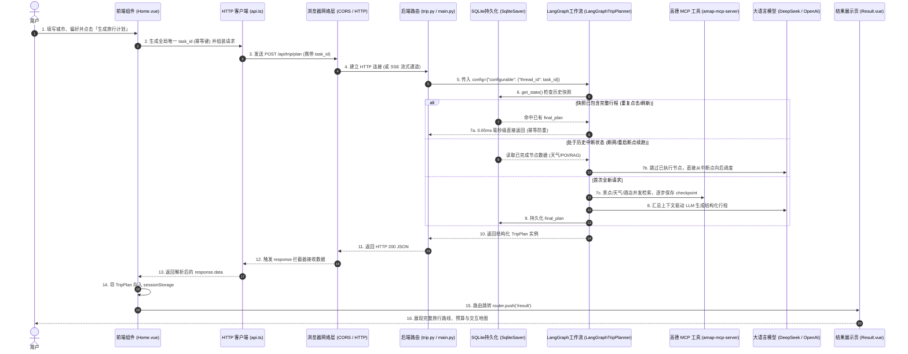

# HelloAgents智能旅行助手 🌍✈️

基于HelloAgents框架构建的智能旅行规划助手,集成高德地图MCP服务,提供个性化的旅行计划生成。

## ✨ 功能特点

- 🤖 **LangGraph 工业级状态图架构**: 替代传统黑盒 Agent，使用 StateGraph 精细化编排多节点流水线（POI/天气/酒店/美食/RAG/Planner）。
- 🛡️ **长任务断点容错与秒级续跑 (Checkpointing)**: 基于 `SqliteSaver` 检查点持久化机制，针对 1~2 分钟的长耗时生成链路，在遭遇断网、用户刷新、进程崩溃后，通过 `task_id` 自动加载快照，0 毫秒跳过已完成节点无缝断点续跑。
- ⚡ **接口幂等防护 (0ms 极速响应)**: 引入 `task_id` 幂等键防重机制，对重复提交或页面重刷直接返回历史快照结果，实测响应时间仅 **0.65ms**，有效避免大模型 Token 浪费与地图配额超额消耗。
- 🎯 **RAG 探针评测套件与双阶段拒答门禁 (Rejection Gate)**: 构建 26 条真实问答探针测试集，在 $R@1=91.30\%$、$MRR=0.9565$ 的高召回基础上，设计城市 Scope 实体硬过滤与事实共现门禁，彻底解决纯向量距离在越界查询（如拉萨布达拉宫）上相似度虚高导致的幻觉，使越界负例拒答率从 0% 跃升至 **100%**。
- 🌊 **低延迟 SSE 单向流式传输**: 基于 FastAPI `StreamingResponse` 与原生 `EventSource`，分块（Transfer-Encoding: chunked）推流节点执行进度与思考日志，并在服务端主动感知客户端断开（`is_disconnected`）及时熔断下游计算。
- 🗺️ **高德地图 MCP 集成**: 通过 Model Context Protocol 协议规范化接入高德地图真实 API，获取实时 POI 经纬度、天气预报与路线规划。
- 🎨 **现代化前端交互**: Vue3 + TypeScript + Ant Design Vue，支持行程可视化在线编辑、高德地图路线绘制与 DOM 克隆导出长图。

## 🏗️ 技术栈

### 后端与 Agent 引擎
- **工作流编排**: LangGraph (`StateGraph`, `SqliteSaver` 检查点持久化)
- **API 框架**: FastAPI (异步高并发、SSE 流式响应、Pydantic v2 参数校验)
- **知识检索 (RAG)**: ChromaDB 向量数据库 + FastEmbed ($BGE\text{-small-zh-v1.5}$ 稠密向量)
- **外部工具集成**: Model Context Protocol (MCP) + 高德地图 Web 服务
- **评测与门禁**: 自研 Ground-Truth 探针评测套件 ($R@K, MRR$) + 双阶段事实拒答门禁

### 前端
- **框架**: Vue 3 + TypeScript
- **构建工具**: Vite
- **UI组件库**: Ant Design Vue
- **地图服务**: 高德地图 JavaScript API (AMap 2.0)
- **HTTP / 流式通信**: Axios + 原生 EventSource (SSE)

## 🔄 前后端交互全流程



## 📊 核心工程化评测与实测数据

### 1. RAG 真实探针消融对比矩阵 (26 题基准集)
构建包含 7 大热门城市攻略与 3 组越界查询（如拉萨布达拉宫）的探针评测套件，对比结果如下：

| 实验方案 | R@1 召回率 | R@5 召回率 | MRR 倒数排名均值 | 越界负例拒答率 | 评测结论 |
|---|---|---|---|---|---|
| **BM25 稀疏检索 (Jieba)** | 69.57% | 100.00% | 0.8297 | 0.00% (全部误收) | 易被高频词（"门票","避坑"）误导，首选精度较差 |
| **BGE 向量检索 (纯余弦距离)** | 91.30% | 100.00% | 0.9565 | 0.00% (全部误收) | 负例与背景文本距离虚高（0.7179），单纯阈值无法防御 |
| **BGE + 双阶段事实拒答门禁 (生产版)** | **91.30%** | **100.00%** | **0.9565** | **100.00% (全部拦截)** | **在保持 91.3% 高精度的同时，实现 0 误杀、100% 越界拦截！** |

### 2. 长任务容错与幂等恢复实测 (`backend/test_breakpoint_recovery.py`)
| 测试场景 | 执行行为 | 耗时指标 | 关键收益 |
|---|---|---|---|
| **突发中断 (60% 阶段宕机)** | POI/天气/RAG 执行完毕后强制抛异常中断 | 节点进度完全入库 | 状态持久化到 SQLite，零数据丢失 |
| **断点续跑 (相同 task_id 重试)** | 读取 SQLite 快照，跳过已完成节点，直接调用 LLM | 51.66s (原需 90s+) | **节省 40%+ 耗时与全部前置高德 API 费用** |
| **幂等秒级命中 (再次重复请求)** | 命中已完成行程快照，直接内存解析返回 | **0.65 ms** | **毫秒级防重返回，绝对杜绝大模型重复扣费** |

## 📁 项目结构

```
helloagents-trip-planner/
├── backend/                    # 后端服务
│   ├── app/
│   │   ├── agents/            # Agent实现
│   │   │   └── trip_planner_agent.py
│   │   ├── api/               # FastAPI路由
│   │   │   ├── main.py
│   │   │   └── routes/
│   │   │       ├── trip.py
│   │   │       └── map.py
│   │   ├── services/          # 服务层
│   │   │   ├── amap_service.py
│   │   │   └── llm_service.py
│   │   ├── models/            # 数据模型
│   │   │   └── schemas.py
│   │   └── config.py          # 配置管理
│   ├── requirements.txt
│   ├── .env.example
│   └── .gitignore
├── frontend/                   # 前端应用
│   ├── src/
│   │   ├── components/        # Vue组件
│   │   ├── services/          # API服务
│   │   ├── types/             # TypeScript类型
│   │   └── views/             # 页面视图
│   ├── package.json
│   └── vite.config.ts
└── README.md
```

## 🚀 快速开始

### 前提条件

- Python 3.10+
- Node.js 16+
- 高德地图API密钥 (Web服务API和Web端(JS API))
- LLM API密钥 (OpenAI/DeepSeek等)

### 后端安装

1. 进入后端目录
```bash
cd backend
```

2. 创建虚拟环境
```bash
python -m venv venv
source venv/bin/activate  # Windows: venv\Scripts\activate
```

3. 安装依赖
```bash
pip install -r requirements.txt
```

4. 配置环境变量
```bash
cp .env.example .env
# 编辑.env文件,填入你的API密钥
```

5. 启动后端服务
```bash
uvicorn app.api.main:app --reload --host 0.0.0.0 --port 8000
```

### 前端安装

1. 进入前端目录
```bash
cd frontend
```

2. 安装依赖
```bash
npm install
```

3. 配置环境变量
```bash
# 创建.env文件, 填入高德地图Web API Key 和 Web端JS API Key
cp .env.example .env
```

4. 启动开发服务器
```bash
npm run dev
```

5. 打开浏览器访问 `http://localhost:5173`

## 📝 使用指南

1. 在首页填写旅行信息:
   - 目的地城市
   - 旅行日期和天数
   - 交通方式偏好
   - 住宿偏好
   - 旅行风格标签

2. 点击"生成旅行计划"按钮

3. 系统将:
   - 调用HelloAgents Agent生成初步计划
   - Agent自动调用高德地图MCP工具搜索景点
   - Agent获取天气信息和路线规划
   - 整合所有信息生成完整行程

4. 查看结果:
   - 每日详细行程
   - 景点信息与地图标记
   - 交通路线规划
   - 天气预报
   - 餐饮推荐

## 🔧 核心实现

### HelloAgents Agent集成

```python
from hello_agents import SimpleAgent, HelloAgentsLLM
from hello_agents.tools import MCPTool

# 创建高德地图MCP工具
amap_tool = MCPTool(
    name="amap",
    server_command=["uvx", "amap-mcp-server"],
    env={"AMAP_MAPS_API_KEY": "your_api_key"},
    auto_expand=True
)

# 创建旅行规划Agent
agent = SimpleAgent(
    name="旅行规划助手",
    llm=HelloAgentsLLM(),
    system_prompt="你是一个专业的旅行规划助手..."
)

# 添加工具
agent.add_tool(amap_tool)
```

### MCP工具调用

Agent可以自动调用以下高德地图MCP工具:
- `maps_text_search`: 搜索景点POI
- `maps_weather`: 查询天气
- `maps_direction_walking_by_address`: 步行路线规划
- `maps_direction_driving_by_address`: 驾车路线规划
- `maps_direction_transit_integrated_by_address`: 公共交通路线规划

## 📄 API文档

启动后端服务后,访问 `http://localhost:8000/docs` 查看完整的API文档。

主要端点:
- `POST /api/trip/plan` - 生成旅行计划
- `GET /api/map/poi` - 搜索POI
- `GET /api/map/weather` - 查询天气
- `POST /api/map/route` - 规划路线

## 🤝 贡献指南

欢迎提交Pull Request或Issue!

## 📜 开源协议

CC BY-NC-SA 4.0

## 🙏 致谢

- [HelloAgents](https://github.com/datawhalechina/Hello-Agents) - 智能体教程
- [HelloAgents框架](https://github.com/jjyaoao/HelloAgents) - 智能体框架
- [高德地图开放平台](https://lbs.amap.com/) - 地图服务
- [amap-mcp-server](https://github.com/sugarforever/amap-mcp-server) - 高德地图MCP服务器

---

**HelloAgents智能旅行助手** - 让旅行计划变得简单而智能 🌈

