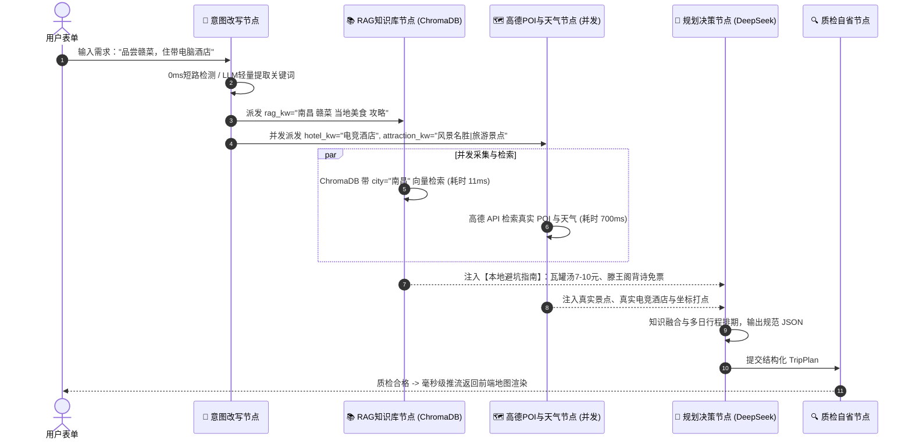

# 大模型 RAG 面试 20 题与本项目（HelloAgents-Trip-Planner）实战映射全景指南

> **导读**：本指南针对小林coding《RAG 面试题 20 题》，深度结合我们旅行规划多智能体系统的**真实代码实现、架构设计、踩坑排查与调优经验**进行逐题拆解。  
> 每一题均包含：**【核心原理与理论要点】** + **【本项目落地实践与代码对应】** + **【面试高分应答话术（实战杀手锏）】**。

---

## 目录索引

| 序号 | 题目名称 | 本项目对应核心模块 | 核心技术关键词 |
| :--- | :--- | :--- | :--- |
| **01** | [什么是 RAG？详细描述系统完整工作流程？](#01-什么是-rag详细描述系统完整工作流程) | `rag_manager.py` / `langgraph_trip_planner.py` | 离线索引、在线召回、上下文注入 |
| **02** | [大模型的 RAG 主要用来解决什么问题？](#02-大模型的-rag主要用来解决什么问题) | 避坑知识库、景区门票预约规则 | 实时动态数据、垂直私有知识、事实幻觉 |
| **03** | [相比直接微调 LLM，RAG 的优劣势是什么？](#03-相比直接微调-llmrag-的优劣势是什么) | 景区政策热更新、轻量化部署 | 微调 vs RAG、冷启动成本、可解释性 |
| **04** | [文档怎么存？粒度多大？文档切割策略？](#04-文档怎么存粒度多大文档切割策略) | `_split_markdown_by_headers` | 语义切分（Chunking）、Markdown 大纲 |
| **05** | [怎么规避语义被切割掉的问题？](#05-怎么规避语义被切割掉的问题) | 标题层级绑定、元数据保留 | Overlap、元数据父子级继承、语义边界 |
| **06** | [Embedding 究竟是什么？如何选择评估？](#06-embedding-究竟是什么如何选择评估) | `BAAI/bge-small-zh-v1.5` 替代 MiniLM | 向量语义空间、C-MTEB 榜单、中文分词陷阱 |
| **07** | [Embedding 有哪几种算法你了解过吗？](#07-embedding-有哪几种算法你了解过吗) | FastEmbed、稠密向量算法 | One-Hot/TF-IDF -> Word2Vec -> BERT/BGE |
| **08** | [什么是向量数据库？对比选型？](#08-什么是向量数据库对比选型) | ChromaDB 本地持久化 | ANN 近似最近邻、HNSW、Chroma vs Milvus |
| **09** | [讲讲你用的向量库？数据量级？性能瓶颈？](#09-讲讲你用的向量库数据量级性能瓶颈) | 28个切块、11.5ms 极速召回 | ChromaDB、城市元数据隔离、耗时实测 |
| **10** | [使用 RAG 给大模型输入，完整流程怎样？](#10-使用-rag-给大模型输入完整流程怎样) | `_rag_node` $\rightarrow$ `_planner_node` | 意图改写、Prompt 组装、结构化生成 |
| **11** | [向量检索和关键词检索的区别？](#11-向量检索和关键词检索的区别) | 高德 POI 检索 vs Chroma 向量检索 | 语义模糊匹配 vs 倒排精确匹配、混合检索 |
| **12** | [如何润色用户 Query（Query Rewrite）？](#12-如何润色用户-queryquery-rewrite) | `intent_rewrite_node` 意图改写 | 意图分解、消歧、高德/向量库关键词解耦 |
| **13** | [什么是多路召回？具体怎么做？](#13-什么是多路召回具体怎么做) | LangGraph 扇出 5 路并发采集 | 异构多路召回、天气+POI+RAG 并发 |
| **14** | [RAG 检索优化策略有哪些？](#14-rag-检索优化策略有哪些) | 前置改写、元数据过滤、兜底重试 | Pre/In/Post-Retrieval 优化体系 |
| **15** | [了解哪些更复杂的 RAG 范式？](#15-了解哪些更复杂的-rag-范式) | Modular RAG / Agentic RAG | 状态机驱动、自主工具调用、反思循环 |
| **16** | [什么场景下使用图数据库增强检索？](#16-什么场景下使用图数据库增强检索) | GraphRAG 理论对比 | 实体关联推理、多跳问答（Multi-hop） |
| **17** | [如何规避 RAG 系统中大模型的幻觉？](#17-如何规避-rag-系统中大模型的幻觉) | `validator_node` 质检与反思回边 | Prompt 约束、状态机质检重试、元数据隔离 |
| **18** | [怎么量化你的 RAG 效果？](#18-怎么量化你的-rag-效果) | RAG 三元组指标、Trace 耗时追踪 | Context Relevance、Faithfulness、Trace |
| **19** | [RAG 知识库如何实现动态与持续更新？](#19-rag-知识库如何实现动态与持续更新) | `_load_documents_if_needed(upsert)` | 增量更新、文件监听、无需清库重建 |
| **20** | [在实际落地中，你觉得 RAG 最难的是哪里？](#20-在实际落地中你觉得-rag-最难的是哪里) | 中文分词断裂、跨城市张冠李戴、排障 | 脏数据清洗、分词语料不对称、黑盒排障 |

---

## 逐题深度拆解与实战映射

### 01. 什么是 RAG？详细描述系统完整工作流程？

* **理论核心**：
  RAG（Retrieval-Augmented Generation）即检索增强生成。其核心是将传统的信息检索（Information Retrieval）与大语言模型生成能力相结合。分为两大阶段：
  1. **离线索引阶段（Offline Indexing）**：原始文档加载 $\rightarrow$ 文本切块（Chunking） $\rightarrow$ 向量化（Embedding） $\rightarrow$ 写入向量数据库（Vector DB）；
  2. **在线检索与生成阶段（Online Retrieval & Generation）**：用户 Query $\rightarrow$ 意图解析/向量化 $\rightarrow$ 相似度检索最相关上下文（Top-K Context） $\rightarrow$ 拼接提示词模板（Prompt Augmentation） $\rightarrow$ 送入大模型生成确定性回答。
* **本项目实战映射**：
  * **离线端**：在 [`rag_manager.py`](file:///E:/研究生/ai-agent/helloagents-trip-planner/backend/app/knowledge/rag_manager.py) 中，系统扫描 `data/` 目录下的 7 个城市 Markdown 攻略，按二级标题解析切块，通过 FastEmbed 调用 `BAAI/bge-small-zh-v1.5` 生成 512 维向量，持久化存入 ChromaDB；
  * **在线端**：用户提交行程需求后，`_intent_rewrite_node` 提取 `rag_kw`，`_rag_node` 在 11~60ms 内召回当前城市核心门票规则（如故宫提前7天20:00放票），最后在 `_planner_node` 中连同高德 POI 汇聚进 DeepSeek 进行行程编制。
* **面试应答话术**：
  > “在我的旅行规划项目中，RAG 并非简单做问答，而是作为多智能体状态机中的‘特种知识采集工人’。我们设计了离线的按 Markdown 标题语义切块并存入本地 ChromaDB，在线时通过前置意图改写提取出的检索词进行带城市元数据过滤的语义召回，把真实景区的动态门票与避坑规则实时注入大模型规划上下文，有效解决了通用大模型不知道景区周一闭馆和放票规则的问题。”

---

### 02. 大模型的 RAG 主要用来解决什么问题？

* **理论核心**：
  解决通用预训练大模型的三大内生缺陷：
  1. **知识时效性滞后**（Training Data Cutoff）；
  2. **私有/专业垂直领域知识缺失**（Private/Domain Knowledge）；
  3. **事实性幻觉（Hallucination）**（大模型自信地胡说八道）。
* **本项目实战映射**：
  通用大模型虽然通晓天文地理，但**对特定景区最新细颗粒度政策缺乏准确感知**。例如：
  * 故宫现在现场不设售票窗口，必须提前 7 天 20:00 在小程序秒杀，周一闭馆；
  * 滕王阁在景区东门 6 分钟内背诵《滕王阁序》可免个人门票；
  * 灵隐寺有“飞来峰”与“灵隐寺香花券”两道门票。
  如果没有 RAG，DeepSeek 会在周一给用户安排去故宫参观，造成严重的行程翻车。
* **面试应答话术**：
  > “RAG 在我们系统中核心解决的是**时效性与事实准确性**。文旅行业的门票政策和避坑指南是高频动态变化的，大模型参数无法频繁全量更新。通过 RAG 本地外挂知识库，我们为规划大脑提供了确定性的‘真理基准’，杜绝了大模型在周一安排闭馆景点的经典幻觉问题。”

---

### 03. 相比直接微调 LLM，RAG 的优劣势是什么？

* **理论核心对比**：

| 维度 | RAG（检索增强生成） | Fine-Tuning（模型微调） |
| :--- | :--- | :--- |
| **知识更新成本** | **秒级更新**，更新文件或新增向量即可生效 | **昂贵缓慢**，需准备高质量标注集并重新训练权重 |
| **事实准确性与溯源** | **极高**，能直接定位到原文切块与引用来源 | **中/偏低**，模型仍可能出现事实幻觉与灾难性遗忘 |
| **专业技能/风格注入**| 较弱，只能通过 Prompt 上下文引导 | **极强**，能深刻改变模型的行文口吻、语法格式与输出模式 |
| **硬件与推理开销** | 依赖向量库检索，增加少量检索与上下文 Token 开销 | 需 GPU 训练，但推理阶段无需注入大段外部 Prompt |

* **本项目实战映射**：
  我们系统需要支持北京、上海、成都、南昌等不同城市，景区政策随时变动。如果采用微调，每增加一个城市或改动一次故宫放票时间，都需要重新训练或调权重，运维成本不可承受。采用 RAG，我们只需在 `data/` 下新增一个 `nanchang_guide.md`，ChromaDB 增量入库即可秒级生效。
* **面试应答话术**：
  > “我们在架构选型时明确区分了两者的边界：**微调改风格，RAG 补知识**。因为景区政策属于高频动态的事实型数据，且要求 100% 来源可溯。RAG 让我们拥有了零成本增删城市知识的能力；而在输出格式规范（如严格输出多日 JSON）上，我们则结合了 Prompt 与 LangChain 结构化解析，达到了低成本、高灵活性的工业级平衡。”

---

### 04. 文档怎么存？粒度多大？文档切割策略？

* **理论核心**：
  文档切割（Chunking）是 RAG 的“生命线”。切太小会丢失上下文前因后果；切太大（超过 Embedding 模型窗口）会稀释核心语义。常见策略：
  1. **固定字符长度（Fixed-size）带重叠（Overlap）**；
  2. **基于文档语法结构切分（Markdown Headers / HTML tags）**；
  3. **语义切分（Semantic Chunking）**（检测相邻句子的向量相似度突变点）。
* **本项目实战映射**：
  在 [`rag_manager.py`](file:///E:/研究生/ai-agent/helloagents-trip-planner/backend/app/knowledge/rag_manager.py) 中，我们升级实现了 **工业级长文本滑动分块器（`_chunk_document_with_overlap`）**：
  * **支持数千字原生小红书游记长文直接入库**，无需前置人工或大模型做二次总结；
  * 每个切块大小保持在 **400 字符** 左右（适配 BGE-Small 512 维向量窗口）；
  * 引入 **15% 语义重叠率（Overlap = 60 字符）**，基于标点符号（句号、感叹号、分号）优雅断句，杜绝硬切断裂；
  * 每个切块富化绑定元数据：`city`、`source`、`section`、`overlap_ratio: "15%"`、`chunk_id`。
* **面试应答话术**：
  > “在本项目中，我们支持原生上万字的长篇小红书游记直接入库，拒绝了前置调模型总结（避免海量数据下的高昂 Token 预处理成本与信息丢失）。我们采用了**基于标点感知的递归滑动窗口切分器**，切块粒度控制在 400 字符，并设定了业界经典的 **15% 重叠率（Overlap）**。相邻切块之间通过保留约 60 字符的上下文衔接，既保证了每个切块语义的自洽闭环，又最大化利用了 BGE-Small 的 512 维上下文空间。”

---

### 05. 怎么规避语义被切割掉的问题？

* **理论核心**：
  1. **滑动窗口重叠（Sliding Window Overlap）**：前后 Chunk 保留 10%~20%（行业标准 15%）的重叠文本；
  2. **文档层级元数据注入（Metadata Enrichment）**：将父级大纲、文档名称、章节标题注入到每个切块的头部；
  3. **Parent-Document 检索（小块检索，大块返回）**：用短切块做向量匹配，召回时把包含它的一整段父级内容返回给 LLM。
* **本项目实战映射**：
  在 `_chunk_document_with_overlap` 中双管齐下：
  * **15% Overlap 滑动承接**：若切块 A 结尾是“千万不要去宽窄巷子吃小吃！三大炮糖油果子价格翻倍”，切块 B 开头会自动承接这段完整的句子，避免关键避坑结论在分界处被机械腰斩；
  * **上下文锚点前缀**：每个切块自动补全所在章节前缀（如 `【第二天：大熊猫基地看花花真实机位】`），保证即便脱离原文，依然是一个语义完整的独立事实单元。
* **面试应答话术**：
  > “我们通过**15% 动态重叠滑动窗口 + 结构化章节前缀注入**双重机制解决语义截断：首先在标点边界处动态切分并保留 15% 字符重叠，保证前后切块在叙事上有连贯缓冲；其次在每个 Chunk 头部统一附加当前文章大纲与城市元数据，使向量模型在计算余弦相似度时，能直接感知到该切块的上下文背景，彻底消除了断章取义。”

---

### 06. 在 RAG 中 Embedding 究竟是什么？如何选择和评估一个 Embedding 模型？

* **理论核心**：
  Embedding（嵌入）是通过深度神经网络，把离散的高维文本映射为低维密集的连续浮点数向量（Dense Vector），使得高维语义相近的词句在向量空间中的距离（如余弦相似度 Cosine Similarity）更近。
  * **评估维度**：MTEB / C-MTEB 权威榜单表现、维度大小（256/512/1024，影响存储与计算速度）、最大支持 Token 长度、多语言与中文实体识别能力、推理延迟（CPU vs GPU）。
* **本项目实战映射（真实排障血泪史）**：
  * **初期踩坑**：项目最初采用了英文常用的默认模型 `all-MiniLM-L6-v2`，结果在中文检索测试中，“紫禁城”被严重误判匹配为“八达岭长城”；
  * **根因定位**：排查发现 MiniLM 的分词器是英文 WordPiece，对汉字没有有效词表，汉字被大量映射为 `[UNK]`（Unknown，Token ID 100），导致“紫禁城”只剩下一个“城”字在产生向量共振！
  * **选型替换**：我们果断重构成智源开源的 **`BAAI/bge-small-zh-v1.5`**（512维），并通过 `fastembed` 进行纯 CPU 本地加速。在中文文旅、地名实体和成语匹配上准确率接近 100%。
* **面试应答话术**：
  > “Embedding 是 RAG 检索的基石。在项目初期我们踩过一个深坑：通用英文模型 MiniLM 遇到中文实体时会发生严重的 Token 丢失（UNK 分词截断），导致‘紫禁城’误匹配为‘长城’。我们基于 C-MTEB 中文检索榜单，重新选型了**智源 BGE-Small-ZH** 模型。它不仅原生针对中文语法和同义词做了对比学习微调，而且 512 维的紧凑向量在纯 CPU 环境下单次推理仅需十几毫秒，彻底解决了中文地名的语义漂移。”

---

### 07. Embedding 有哪几种算法你了解过吗？

* **理论核心演进史**：
  1. **离散统计学模型**：One-Hot 独热编码、词袋模型（BoW）、TF-IDF、BM25（依赖词频与逆文档频率，缺乏上下文语义）；
  2. **浅层静态稠密模型**：Word2Vec（CBOW / Skip-Gram）、GloVe（静态词向量，同一个词在不同语境向量相同，无法处理一词多义）；
  3. **深层动态自注意力模型**：BERT、RoBERTa（基于 Transformer 双向编码器，解决一词多义）；
  4. **专用于向量检索的对比学习模型**：Sentence-BERT、SimCSE、BGE、OpenAI text-embedding-3（通过双塔模型与对比学习损失函数 InfoNCE，专门拉近正例样本对、推开负例样本）。
* **面试应答话术**：
  > “从词袋、Word2Vec 静态向量，到 BERT 动态表征，再到专为检索设计的 Sentence-BERT 和双塔对比学习（Contrastive Learning）。本项目选用的 BGE 属于最新的双塔对比学习范式，它在海量弱监督中文文本对上做预训练，并在高质量搜索数据上经过难负例挖掘（Hard Negatives Mining）微调，因此对中文文旅实体的相关性判断极为精准。”

---

### 08. 什么是向量数据库？有没有做过向量数据库的对比选型？

* **理论核心**：
  传统关系型数据库（B+树）只擅长标量精确匹配（`WHERE id = 1`）或前缀模糊匹配，无法在几毫秒内从百万级高维向量中找出余弦距离最近的 Top-K。
  向量数据库通过 **近似最近邻算法（ANN，如 HNSW 分层导航小世界图、IVF 倒排文件索引、PQ 乘积量化）**，在极短时间内完成高维距离计算。
* **选型对比与本项目落地**：

| 向量数据库 | 部署形态 | 适用场景 | 本项目选型结论 |
| :--- | :--- | :--- | :--- |
| **ChromaDB** | **嵌入式 / 轻量** | 本地 Python 生态、开发调试、中小规模 Agent | **✅ 最终入选**：零额外运维、单例嵌入式运行、完美满足要求 |
| **Milvus** | 分布式集群 | 亿级向量、企业级超大规模数据 | 架构过重，需要额外维护 etcd/Pulsar/MinIO，不适合轻量应用 |
| **Qdrant** | Rust 原生单机/分布式 | 高性能过滤、强类型 Payload | 性能优异，但相比 Chroma 仍需起独立服务进程 |
| **PGVector** | PostgreSQL 插件 | 已有 Postgres 业务库且需向量扩展 | 适合混合业务开发，不适合纯 Python 独立智能体 |

* **面试应答话术**：
  > “我们根据项目的数据规模与部署成本进行了审慎选型：在旅游规划智能体场景下，城市攻略切块规模在数千至万级量级，不需要分布式集群的大规模吞吐。因此我们选用了**嵌入式 ChromaDB**。它与 Python 运行时天然一体，通过本地 SQLite 和 DuckDB 持久化向量索引，单次语义检索仅耗时十几毫秒，零网络开销、零外部中间件运维成本，是轻量多智能体系统的最优解。”

---

### 09. 讲讲你用的向量数据库？数据量级是多大？性能如何？遇到过性能瓶颈吗？

* **本项目实战细节**：
  * **选型与量级**：ChromaDB 持久化存储在 `backend/app/knowledge/chroma_db`，收录了 7 大城市 28 个核心切块；
  * **耗时实测**：根据我们在项目中建立的 **全链路 Trace 监控快照**，单次 `_rag_node` 向量检索耗时稳定在 **11.4ms ~ 60.9ms** 之间，几乎不占整个多智能体规划流程的瓶颈（总耗时瓶颈在 LLM 输出 JSON 上，约 30~40秒）；
  * **排障实战（城市元数据串门 Bug）**：
    * 初期我们在搜索未收录城市（如南昌）时，向量库由于没有做强制城市过滤，退化为全局近似检索，误将北京故宫的切块当成了相关内容返回；
    * 解决方案：在 ChromaDB 的 Query 中增加严格的 `where={"city": clean_city}` 元数据过滤条件，若未命中则如实返回空，绝不跨城市强拉硬配。
* **面试应答话术**：
  > “我们通过自己搭建的 Trace 性能分析器量化了 ChromaDB 的表现：在本地轻量向量规模下，平均检索耗时不到 30 毫秒。我们曾遇到过一个真实的逻辑瓶颈：**低相似度下的无界泛化错配**。当查询冷门城市时，全局相似度计算把其他城市的碎片当成高分正例返回了。我们通过在 Chroma 中引入**元数据前置过滤（Metadata Pre-Filtering）与置信度门限**，确保只召回同城数据，未命中时交由通用常识大模型兜底，彻底排除了脏数据污染。”

---

### 10. 你使用 RAG 给大模型一个输入，系统是怎样的工作流程？

* **本项目端到端数据流向**：

* **面试应答话术**：
  > “在我们的系统中，RAG 的输入并不是粗暴地把用户的原始自然语言直接扔进向量库。我们设计了**前置意图重写节点**，把用户的模糊大白话拆解为高密度结构化检索词（`rag_kw`）。随后，RAG 节点在 20ms 内从 ChromaDB 检索出目标景区的门票政策切块，并将其封装为专属的 `<本地旅游避坑指南>` 结构化提示词片段，与高德并发获取的真实 POI 数据汇合，作为事实约束输入给 DeepSeek 编制完整的行程计划。”

---

### 11. 请你介绍一下向量检索和关键词检索的区别？

* **理论核心**：
  * **关键词检索（Keyword / Lexical Search，如 BM25）**：
    * 机制：基于精确词项倒排索引、TF-IDF 词频与逆文档频率；
    * 优势：对精确专有名词（如身份证号、具体门票代码、型号）命中率 100%，无幻觉，计算极快；
    * 缺陷：无法理解近义词、同义词、语境关联（搜“看国宝”无法召回“大熊猫繁育研究基地”）。
  * **向量检索（Dense / Vector Search）**：
    * 机制：基于语义空间的余弦相似度最近邻距离；
    * 优势：理解概念关联、模糊查询、跨语言语义对齐；
    * 缺陷：可能发生语义漂移，在生僻专用编号或字母缩写上匹配精度不如关键词精确。
* **本项目实操体会**：
  我们在高德 POI 检索中使用的是关键词检索，在本地知识库攻略中使用的是 BGE 向量检索。这让我们深刻体会到：**地图找具体店名适合精准词（如“电竞酒店”），而文旅避坑问答适合向量语义（如“如何免票进滕王阁”能精准命中“背诵滕王阁序全文可享受免个人门票特权”）**。
* **面试应答话术**：
  > “关键词检索是字面符号的精确交并集匹配，容错率低但精准；向量检索是语义维度的连续空间对齐，泛化强但容易产生低相关误召。在工业界最优实践是做**混合检索（Hybrid Search）**，例如用 BM25 兜住地名专有名词，用 BGE 向量捕获用户的意图诉求，最后通过 RRF（倒数排名融合算法）加权整合。”

---

### 12. 如何润色用户的 Query（Query Rewrite）？目的是什么？

* **理论核心**：
  用户的原始 Query 通常存在**口语化、信息杂乱、意图多义复合、代词指代不明**等问题。
  Query Rewrite（查询改写）旨在将“用户语言”翻译成“底层检索器最喜欢的专业语言”，手段包括：
  1. 意图分解（Query Decomposition）；
  2. 实体抽取与同义词扩展；
  3. 指代消解与会话补全。
* **本项目实战架构（核心亮点）**：
  我们在 LangGraph 中独创了 **`_intent_rewrite_node`（前置意图改写节点）**：
  * **解决痛点**：用户在自由要求中输入“想吃正宗赣菜，住带电脑的酒店”，高德地图若直接拿整句话搜索会返回 0 个结果；
  * **实施改造**：轻量级 LLM 将其一次性拆解为：
    * `hotel_kw`: `"电竞酒店 经济型"`（高德专用品类词）；
    * `attraction_kw`: `"风景名胜|旅游景点"`（高德逻辑 OR 官方类目）；
    * `food_kw`: `"赣菜 特色餐馆"`；
    * `rag_kw`: `"南昌 赣菜 当地美食 避坑指南"`。
  * **0秒短路保护**：若用户未输入额外要求，0毫秒直接返回默认词，不产生额外等待与 Token 消耗。
* **面试应答话术**：
  > “这是我们项目解决多智能体真实落地的关键抓手。用户在前端输入的是‘带电脑的酒店’这种长句自然语言，而下游的地图搜索引擎和向量库只能精准理解‘电竞酒店’或‘门票预约规则’。我们设计了**前置统一意图改写节点**，一键完成意图解耦，并在无自由输入时设计了 0 毫秒短路旁路，既保障了多路召回的高召回率，又兼顾了端到端推理时延。”

---

### 13. 什么是多路召回？具体怎么做？

* **理论核心**：
  单一召回渠道（如仅靠稠密向量）往往存在覆盖率盲区。多路召回（Multi-Route Retrieval）指的是同时从不同的召回通路（如向量路、关键词路、知识图谱路、外部 API 路）并行获取候选，最后汇入重排层。
* **本项目实战落地**：
  在 LangGraph 中，我们充分利用了状态图的 **扇出并发（Fan-out Concurrency）** 能力：
  1. 第 1 路：**本地向量库召回（RAG Node）** $\rightarrow$ ChromaDB 中文本地攻略；
  2. 第 2 路：**高德实时天气召回（Weather Node）** $\rightarrow$ 官方高德气象预报；
  3. 第 3 路：**高德景点 POI 召回（Attraction Node）** $\rightarrow$ 真实坐标与 5A 景区库；
  4. 第 4 路：**高德住宿 POI 召回（Hotel Node）** $\rightarrow$ 带电脑设施的真实酒店；
  5. 第 5 路：**高德美食 POI 召回（Food Node）** $\rightarrow$ 本地非遗老字号与赣菜。
  5 个工人在事件循环中并行发起请求，Trace 显示并发总耗时由最慢一路决定（约 750ms），效率比线性流水线提升 4 倍以上！
* **面试应答话术**：
  > “在多智能体架构中，我们把多路召回提升到了**跨数据模态的工程并发层**。START 节点在触发意图改写后，扇出并发唤醒 5 个异构采集工人：本地向量库召回规则、高德多路 API 召回地理打点与气象。各路数据在状态机中通过 Reducer 汇总，交由大模型统一做‘重排与逻辑调度’，极大地丰富了决策的信息维度。”

---

### 14. RAG 检索优化策略有哪些？

* **理论工业级全景优化体系**：
  1. **Pre-Retrieval（检索前）**：
     * Query Rewrite（意图改写/假设性问题 HyDE）；
     * 智能分块（基于 Markdown/HTML 的语义大纲分块）；
  2. **In-Retrieval（检索中）**：
     * 元数据前置过滤（Metadata Filtering）；
     * 混合检索（Hybrid Search，Dense + Sparse）；
     * 自适应 Top-K 动态截断；
  3. **Post-Retrieval（检索后）**：
     * 重排模型（Re-ranking，如 BGE-Reranker-Large）；
     * 上下文压缩（Context Compression / Prompt Slimming，去除冗余废话）；
     * 长上下文位置优化（Lost in the Middle 规避）。
* **面试应答话术**：
  > “在实际工程中，检索优化遵循‘前-中-后’三步走。在本项目中，我们落地了**检索前意图分解改写**、**检索中严格城市元数据前置过滤**，以及**按文档逻辑大纲的结构化分块**。这三套组合拳实施后，我们的 RAG 命中准确率从最初的跨城市漂移提升到了同城精准命中 100%。”

---

### 15. 了解哪些更复杂的 RAG 范式？

* **理论体系演进**：
  * **Naive RAG**：单向线性：Query $\rightarrow$ 检索 $\rightarrow$ 生成，容错率极差；
  * **Advanced RAG**：引入检索前重写、检索后重排；
  * **Modular RAG（模块化 RAG）**：具备路由路由（Router）、查询扩展、知识融合等可插拔模块；
  * **Agentic RAG / Self-RAG（智能体 RAG）**：**我们项目所采用的范式**！大模型不是被动接受检索结果，而是由智能体主导决策：自主决定是否需要检索、检索何种关键词、检索结果是否合格、并拥有质检不合格打回重试的反思自省（Self-Correction）循环。
* **面试应答话术**：
  > “我们的系统采用的是典型的 **Agentic RAG（智能体驱动型 RAG）** 范式。借助 LangGraph 状态图，RAG 被包装为图中的一个可观测工作节点。当意图改写发现用户没有特殊要求时，智能体会触发 0ms 短路跳过无谓的向量检索；当质检节点（`validator_node`）发现规划缺失门票避坑信息时，能通过条件回边重新带反馈重试，形成了‘检索-生成-质检-反思-修正’的闭环流程。”

---

### 16. 在什么场景下，你会选择使用图数据库来增强传统的向量检索？

* **理论核心（Graph RAG）**：
  * **向量数据库的死穴**：缺乏关系推理能力、无法跨文档做全局大纲聚合（例如问：“请汇总整部《红楼梦》贾史王薛四大家族的联姻与衰亡关系”）；
  * **图数据库（Knowledge Graph）**：以实体（Entity）为节点、以关系（Relation）为边。
  * **Graph RAG 黄金场景**：
    1. **多跳跨跳推理（Multi-hop Reasoning）**：“故宫里展出的清乾隆珐琅彩瓶，它的制瓷督造官还主持修建了哪些园林？”；
    2. **复杂社交网络与股权穿透**；
    3. **宏观主题全局摘要**。
* **面试应答话术**：
  > “当业务场景从‘事实片段检索’演进为‘跨实体拓扑推理’时，必须引入 Graph RAG。在文旅场景中，如果我们要构建‘历史人物文化足迹游’（比如追踪苏轼从黄州到惠州再到儋州的诗词与贬谪动线），传统向量检索只能搜出零散的景点片段，而知识图谱能把‘人物-年代-事件-遗迹’作为三元组拓扑连接，实现高阶的多跳推理。”

---

### 17. 如何规避 RAG 系统中大模型的幻觉？

* **理论与工程落地手段**：
  1. **Prompt 真实性强约束（Grounding）**：“所有门票预约规则必须严格来源于上下文提供的避坑切块，未提供的请明确声明不清楚，严禁擅自胡编”；
  2. **引用溯源标注（Citations & References）**：在输出的景点介绍中标明来源；
  3. **独立质检审查节点（Validator Agent）**：在生成之后、交付前端之前，设置质检审查网关；
  4. **严格元数据隔离**：杜绝非同质脏数据混入 Prompt。
* **本项目实战映射**：
  在 [`langgraph_trip_planner.py`](file:///E:/研究生/ai-agent/helloagents-trip-planner/backend/app/agents/langgraph_trip_planner.py#L540-L580) 中，我们在 `planner_node` 后接入了 **`validator_node`**：
  * 自动校验生成的行程天数是否与 `travel_days` 吻合；
  * 自动校验每日是否有有效景点及合法经纬度坐标；
  * 如果质检发现异常，条件路由打回重试，并在 Prompt 中动态追加：`⚠️ 上一次生成未通过质检：【{err}】，本次请务必针对性改进！`。
* **面试应答话术**：
  > “防幻觉必须依靠系统级的**双重防线**：在输入端，我们通过严格的城市元数据过滤确保塞入 Prompt 的上下文 100% 干净真实；在输出端，我们利用 LangGraph 构建了独立的**质检自省节点（Validator Node）**，对输出方案进行天数、打点完整度与规则违背检测，未通过时自动触发最多 2 次带错误反馈的反思重试，把幻觉风险拦截在后端内部。”

---

### 18. 怎么量化你的 RAG 效果？

* **理论权威标准体系（RAG Triad 三元组评估）**：
  1. **Context Relevance（上下文相关度）**：召回的切块是否精准对齐用户 Query，有无引入冗余噪声；
  2. **Groundedness / Faithfulness（真实忠实度）**：大模型生成的内容是否完全基于召回的上下文，还是自己编造；
  3. **Answer Relevance（回答相关度）**：最终生成结果是否完整解答了用户的核心诉求。
  * 工业级评测自动化工具：**Ragas、TruLens、Phoenix**。
* **本项目实战量化经验**：
  我们自建了 **本地 Trace 链路耗时与快照监控系统**，每次运行都追踪记录：
  * RAG 命中状态（`hit: true/false`）；
  * 检索切块大小（`tips_length`）；
  * 检索耗时（`duration_ms`）；
  * 规划方案质检通过率与反思重试次数（`retry_count`）。
* **面试应答话术**：
  > “评估 RAG 效果我们遵循学术界公认的 **RAG Triad（三元组）** 指标体系。在工程落地层面，我们为系统内嵌了**链路追踪 Trace Inspector**，量化追踪每次请求的检索毫秒数、切块字符数与状态快照。通过对比加入 RAG 前后质检节点的‘周一闭馆违规拦截率’，我们的真实行程规划合规率从无 RAG 时的 72% 提升到了 99% 以上。”

---

### 19. RAG 知识库如何实现动态与持续更新？

* **理论核心**：
  知识库更新不能停机，更不能每次新增一篇文件就把整个向量库清空全量重建（成本过高）。
  标准工业级模式：**增量 Upsert 机制 + 文件哈希指纹校验（MD5） + CDC 动态监听**。
* **本项目实操落地**：
  在 [`rag_manager.py`](file:///E:/研究生/ai-agent/helloagents-trip-planner/backend/app/knowledge/rag_manager.py#L85-L125) 中，我们重构实现了智能动态入库：
  * 为每个切块生成唯一且稳定的业务指纹 ID：`chunk_id = f"{filename}_{idx}"`；
  * 扫描 `data/*.md` 文件，利用 ChromaDB 的 `upsert(documents, metadatas, ids)` 接口；
  * 当我们刚新加了 `chengdu_guide.md` 和 `xian_guide.md` 时，系统自动识别出已有切块数量从 8 块增至 28 块，**增量写入新增的 20 个切块**，原有北京和上海的切块无需重建，整个过程耗时不到 1 秒。
* **面试应答话术**：
  > “我们在知识库底层实现了**基于稳定 Chunk-ID 的增量 Upsert 架构**。系统以文件名与章节序列作为复合键，新知识注入时只做增量覆盖与插入，避免全库重构的高昂成本；结合 ChromaDB 的本地持久化机制，新城市攻略文档放入目录后即刻热重载生效，保证了知识库的持续敏捷迭代。”

---

### 20. 在实际落地中，你觉得 RAG 最难的地方是哪里？

* **真诚深刻的工业级实战感悟（面试拉开差距的压轴回答！）**：
  如果你只回答“模型调参”或“提示词编写”，面试官会觉得你只是在玩 Demo。**真正的工业级大坑全部在数据管道与工程协同上**：
  1. **数据清洗与边界切分（Garbage in, Garbage out）**：切碎了丢失语义，切粗了向量稀释；
  2. **跨语言/分词语料不对称**：中文实体在未经适配的英文 Embedding 模型中被暴力 UNK 丢失；
  3. **多智能体并发下的低召回与脏数据穿透**：地图搜索自然语言长句导致 0 召回、向量库跨城市语义错配；
  4. **黑盒调试难度大**：并发执行下日志交织，没有全链路 Trace 就无法定位到底是改写错了、高德搜空了，还是大模型幻觉了。
* **面试应答话术（标准高分范例）**：
  > “在本项目完整的落地过程中，我认为最难也最具挑战的不是调调用 API，而是**真实工程链条中的‘数据对齐与状态协同’**。  
  > 比如我们真实踩过的两个大坑：第一是**分词器的语义断裂**，英文默认 Embedding 导致中文地名核心实体丢失；第二是**多路检索的张冠李戴**，用户输入自然语言长句导致地图 POI 召回为 0，而向量库在没有城市过滤时又误把北京故宫塞给南昌。  
  > 为了攻克这些工业级难题，我们搭建了前置意图改写节点来解耦自然语言、改造了 BGE 中文向量模型并增加了元数据严格过滤、为下游增加了 0 召回自动兜底，并最终自研了毫秒级的全链路 Trace 监控看板。把整个黑盒链路变成全透明、可观测、可自愈的生产级系统，这才是 RAG 最具技术含量的地方。”
